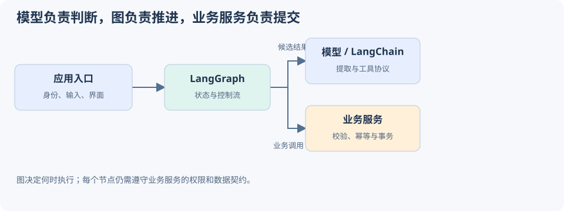
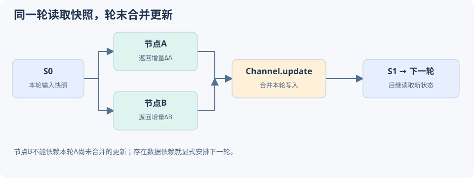
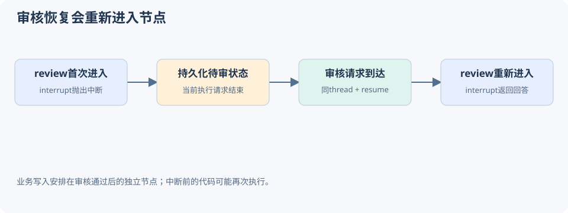
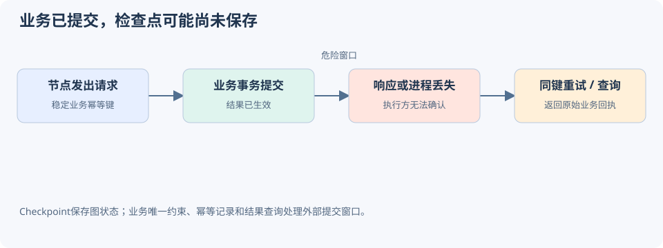
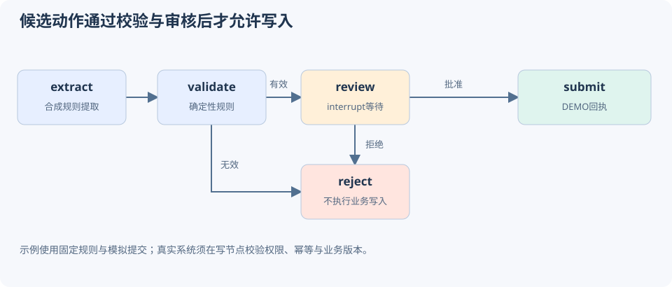

# LangGraph：核心机制、源码解析与工程实践

基线：1.2.16，提交41c9c22fdc83d68a2859d0c9a2b627c8615a792f；核验日期：2026年10月19日。

# LangGraph解决什么问题

## 从一次模型调用到一个可恢复的流程

调用模型生成一段文字，通常一个函数就够了。困难出现在流程需要持续推进时：读取材料、抽取字段、查询业务系统、发现缺项、等待人工补全、再次核验，最后才允许执行操作。中间某次调用失败，不能让用户从头重做；人工审核可能隔一天才回来，也不能一直占着一个HTTP请求。

LangGraph把这些工作组织成有状态的图。节点负责执行，边负责决定后继，State记录流程数据。它允许普通Python规则与模型判断出现在同一个流程中，模型只是其中一类节点。即使完全不用模型，也能学习并运行本手册的全部实验。



## 模型、LangChain、LangGraph与业务服务

|层次|负责的事情|不能由这一层替代的事情|
|---|---|---|
|模型|生成、提取、分类、提出工具调用|证明业务事实真实，授予操作权限|
|LangChain|模型与工具抽象、集成、常见Agent构建方式|自动保证所有业务操作正确|
|LangGraph|状态更新、控制流、执行与恢复|业务数据库事务、用户身份与授权|
|业务服务|资格校验、幂等、交易与审计|推断自然语言中的所有意图|

LangGraph可独立使用。LangChain中的高层Agent适合快速搭建常见循环，自定义StateGraph适合需要精确控制步骤、分支和审核点的流程。两者并非只能选一个：图节点内部也可以调用一个高层Agent。

## 什么时候值得引入

判断依据是流程复杂度。存在循环修正、条件分支、多个并行任务、人工介入或跨请求恢复时，图能把隐含控制流变成显式结构。只有“接收问题→调用模型→返回文本”时，图增加的状态与持久化管理可能超过收益。

本手册按Python Graph API展开，固定LangGraph1.2.16。公开文档随版本更新；实验结果与源码解释均以本手册版本为准。官方定位参考：[Overview](https://docs.langchain.com/oss/python/langgraph/overview)。


# 环境与第一个可运行的图

## 固定版本，先排除模型干扰

在examples目录执行：

```sh
python3.13 -m venv .venv
.venv/bin/python -m pip install -r examples/requirements.lock
.venv/bin/python examples/lab.py
.venv/bin/python examples/sqlite_restart.py
```

初次安装依赖需要网络，运行实验不需要API Key、不连接模型、不访问业务服务。构建网页另外使用`Markdown==3.10.2`，阅读和执行实验无需安装网页生成器。

## State、节点和边如何组合

下面的函数可以直接导入执行：`from examples.lab import minimal; print(minimal())`。它返回输入原文与处理结果，展示节点只提交自己改变的字段。

示例来自[examples/lab.py](examples/lab.py)，依赖导入见该文件开头。

```python
def minimal():
    class State(TypedDict):
        text: str
        result: str
    def normalize(state):
        return {"result": state["text"].strip().upper()}
    builder = StateGraph(State)
    builder.add_node("normalize", normalize)
    builder.add_edge(START, "normalize")
    builder.add_edge("normalize", END)
    graph = builder.compile()
    result = graph.invoke({"text": " hello "})
    assert result == {"text": " hello ", "result": "HELLO"}
    return result
```

`StateGraph(State)`登记状态结构，`add_node`登记执行函数，`add_edge`登记固定路径。`START`和`END`是图的入口与结束标记。`compile()`生成可执行对象，随后通过`invoke`运行。

节点拿到包含当前字段的状态，返回`{"result": "HELLO"}`这一份更新；没有返回的`text`不会因此被删除。不要把State当成共享可变字典，在节点中原地追加列表或修改嵌套对象。返回明确的增量，合并语义才可检查，失败重试也更容易理解。

## 编译不等于训练，也不等于执行

这里的编译是把声明式图转换为运行时可执行的节点、通道与触发器。它会检查图结构、绑定checkpointer等配置，不会训练模型，不会把Python编译成机器码，也不能静态证明节点中的业务代码永远正确。

常见错误是注册完节点就调用builder.invoke；应保留`graph = builder.compile()`返回的对象。另一个错误是编译之后继续修改builder并期待已编译的graph自动同步；完整定义后再编译，修改结构时重新生成运行对象。


# State、Channel与Reducer

## State字段各自拥有更新规则

State可以理解为逻辑上的状态快照；运行时通过Channel管理各个字段的读写和版本。默认字段通常使用LastValue，同一super-step允许一份写入，下一轮可覆盖上一轮的值。它不是“并发写入时谁最后完成谁赢”。

对需要累积的字段，可以通过`Annotated[list[str], operator.add]`声明Reducer。节点每次返回新产生的部分，框架按Reducer合并旧值与更新。若把完整历史再次作为更新返回，列表会重复累积。

例如旧值为`["A"]`，新更新为`["B"]`，加法Reducer得到`["A", "B"]`；若节点返回`["A", "B"]`，就会得到`["A", "A", "B"]`。这类重复来自更新协议，不是模型“记忆混乱”。

## 默认Channel为何会拒绝并行覆盖

源码：[LastValue.update · L56—L67](https://github.com/langchain-ai/langgraph/blob/41c9c22fdc83d68a2859d0c9a2b627c8615a792f/libs/langgraph/langgraph/channels/last_value.py#L56-L67)，固定提交`41c9c22fdc83`，完整函数。

```python
    def update(self, values: Sequence[Value]) -> bool:
        if len(values) == 0:
            return False
        if len(values) != 1:
            msg = create_error_message(
                message=f"At key '{self.key}': Can receive only one value per step. Use an Annotated key to handle multiple values.",
                error_code=ErrorCode.INVALID_CONCURRENT_GRAPH_UPDATE,
            )
            raise InvalidUpdateError(msg)

        self.value = values[-1]
        return True
```

`len(values) != 1`检查的是本轮收集到的写入数量。在并行分支中，即使两份写入恰好内容相同，默认Channel仍不能据此推导业务合并规则。需要累积就定义Reducer；需要单一决策就让分支写不同字段，再由汇总节点决定。

## Reducer在源码中如何识别与调用

源码：[_is_field_binop · L1904—L1922](https://github.com/langchain-ai/langgraph/blob/41c9c22fdc83d68a2859d0c9a2b627c8615a792f/libs/langgraph/langgraph/graph/state.py#L1904-L1922)，固定提交`41c9c22fdc83`，完整函数。

```python
def _is_field_binop(typ: type[Any]) -> BinaryOperatorAggregate | None:
    if hasattr(typ, "__metadata__"):
        meta = typ.__metadata__
        if len(meta) >= 1 and callable(meta[-1]):
            sig = signature(meta[-1])
            params = list(sig.parameters.values())
            if (
                sum(
                    p.kind in (p.POSITIONAL_ONLY, p.POSITIONAL_OR_KEYWORD)
                    for p in params
                )
                == 2
            ):
                return BinaryOperatorAggregate(typ, meta[-1])
            else:
                raise ValueError(
                    f"Invalid reducer signature. Expected (a, b) -> c. Got {sig}"
                )
    return None
```

识别函数读取Annotated元数据中的可调用对象，检查它能否接受两个位置参数，然后生成`BinaryOperatorAggregate`。普通类型注解没有这样的Reducer时，会走其他Channel选择路径。TypedDict主要用于声明结构，它并不会自动替代对外部输入的运行时校验。

源码：[BinaryOperatorAggregate.update · L127—L148](https://github.com/langchain-ai/langgraph/blob/41c9c22fdc83d68a2859d0c9a2b627c8615a792f/libs/langgraph/langgraph/channels/binop.py#L127-L148)，固定提交`41c9c22fdc83`，完整函数。

```python
    def update(self, values: Sequence[Value]) -> bool:
        if not values:
            return False
        if self.value is MISSING:
            self.value = values[0]
            values = values[1:]
        seen_overwrite: bool = False
        for value in values:
            is_overwrite, overwrite_value = _get_overwrite(value)
            if is_overwrite:
                if seen_overwrite:
                    msg = create_error_message(
                        message="Can receive only one Overwrite value per super-step.",
                        error_code=ErrorCode.INVALID_CONCURRENT_GRAPH_UPDATE,
                    )
                    raise InvalidUpdateError(msg)
                self.value = overwrite_value
                seen_overwrite = True
                continue
            if not seen_overwrite:
                self.value = self.operator(self.value, value)
        return True
```

普通更新会执行`self.operator(self.value, value)`。本版本还处理Overwrite以显式覆盖聚合值，同一轮多个Overwrite会产生冲突。本文实验采用普通Reducer，不依赖覆盖操作。

## 合并规则也属于业务设计

列表追加不具备去重能力，数值相加也不具备幂等性。适合并行合并的规则应尽量满足结合律；若结果还要求不受任务排列影响，就需要交换律或明确的业务排序。收集证据时可按证据ID去重、按文档位置排序，不应把任务完成先后当作业务优先级。

详细API参考：[Graph API](https://docs.langchain.com/oss/python/langgraph/graph-api)。


# 从StateGraph到CompiledStateGraph

## 构图阶段保存的是什么

builder保存节点定义、边、条件分支及各Schema对应的Channel。节点名称用于控制流定位，State字段名称用于数据合并，两者是不同维度。节点可以只读取输入Schema的一部分，也可以返回一部分更新。

输入、内部状态与输出可以分别声明Schema。这样可以让内部证据、检查结果与最终对外响应采用不同结构。但Schema本身不构成访问控制：如果把内部对象写入日志、流事件或错误信息，仍会泄漏。应该在接口层明确过滤输出。

## compile的真实路径

源码：[StateGraph.compile · L1177—L1401](https://github.com/langchain-ai/langgraph/blob/41c9c22fdc83d68a2859d0c9a2b627c8615a792f/libs/langgraph/langgraph/graph/state.py#L1177-L1401)，固定提交`41c9c22fdc83`，完整函数。

```python
    def compile(
        self,
        checkpointer: Checkpointer = None,
        *,
        cache: BaseCache | None = None,
        store: BaseStore | None = None,
        interrupt_before: All | list[str] | None = None,
        interrupt_after: All | list[str] | None = None,
        debug: bool = False,
        name: str | None = None,
        transformers: Sequence[Callable[[tuple[str, ...]], Any]] | None = None,
    ) -> CompiledStateGraph[StateT, ContextT, InputT, OutputT]:
        """Compiles the `StateGraph` into a `CompiledStateGraph` object.

        The compiled graph implements the `Runnable` interface and can be invoked,
        streamed, batched, and run asynchronously.

        Args:
            checkpointer: A checkpoint saver object or flag.

                If provided, this `Checkpointer` serves as a fully versioned "short-term memory" for the graph,
                allowing it to be paused, resumed, and replayed from any point.

                If `None`, it may inherit the parent graph's checkpointer when used as a subgraph.

                If `False`, it will not use or inherit any checkpointer.

                **Important**: When a checkpointer is enabled, you should pass a `thread_id`
                in the config when invoking the graph:

                ```python
                config = {"configurable": {"thread_id": "my-thread"}}
                graph.invoke(inputs, config)
                ```

                The `thread_id` is the key used to store and retrieve checkpoints. Use a
                unique ID for independent runs, or reuse the same ID to accumulate state
                across invocations (e.g., for conversation memory).

            interrupt_before: An optional list of node names to interrupt before.
            interrupt_after: An optional list of node names to interrupt after.
            debug: A flag indicating whether to enable debug mode.
            name: The name to use for the compiled graph.
            transformers: Optional sequence of `StreamTransformer` classes or
                configured factories. Classes and factories are instantiated
                per run whenever `stream_events(version="v3")` / `astream_events(version="v3")` is called and are
                propagated to subgraph scopes. Custom factories should follow
                the standard `StreamTransformer` constructor shape by
                accepting `scope` as their first argument. Appended after the
                built-in stream transformers.

        Returns:
            CompiledStateGraph: The compiled `StateGraph`.
        """
        checkpointer = ensure_valid_checkpointer(checkpointer)

        serde_allowlist: set[tuple[str, ...]] | None = None
        if _serde.STRICT_MSGPACK_ENABLED:
            schema_types: list[type[Any]] = [
                self.state_schema,
                self.input_schema,
                self.output_schema,
            ]
            if self.context_schema is not None:
                schema_types.append(self.context_schema)
            for node in self.nodes.values():
                schema_types.append(node.input_schema)
            for branches in self.branches.values():
                for branch in branches.values():
                    if branch.input_schema is not None:
                        schema_types.append(branch.input_schema)
            serde_allowlist = _serde.build_serde_allowlist(
                schemas=schema_types,
                channels=self.channels,
            )
            checkpointer = _serde.apply_checkpointer_allowlist(
                checkpointer, serde_allowlist
            )

        # assign default values
        interrupt_before = interrupt_before or []
        interrupt_after = interrupt_after or []

        # validate the graph
        self.validate(
            interrupt=(
                (interrupt_before if interrupt_before != "*" else []) + interrupt_after
                if interrupt_after != "*"
                else []
            )
        )

        # prepare output channels
        output_channels = (
            "__root__"
            if len(self.schemas[self.output_schema]) == 1
            and "__root__" in self.schemas[self.output_schema]
            else [
                key
                for key, val in self.schemas[self.output_schema].items()
                if not is_managed_value(val)
            ]
        )
        stream_channels = (
            "__root__"
            if len(self.channels) == 1 and "__root__" in self.channels
            else [
                key for key, val in self.channels.items() if not is_managed_value(val)
            ]
        )
        # Apply builder defaults to node specs. Per-node values always win.
        # Error-handler routing and cache_policy are only assigned to regular
        # nodes. Retry and timeout defaults also apply to error-handler nodes.
        defaults = self._node_defaults
        default_handler_name: str | None = None
        if defaults.error_handler is not None:
            if _DEFAULT_ERROR_HANDLER_NODE in self.nodes:
                raise ValueError(
                    f"Auto-generated default error handler node "
                    f"`{_DEFAULT_ERROR_HANDLER_NODE}` already exists."
                )
            default_handler_name = _DEFAULT_ERROR_HANDLER_NODE
            self.nodes[default_handler_name] = StateNodeSpec[Any, ContextT](
                coerce_to_runnable(
                    defaults.error_handler,  # type: ignore[arg-type]
                    name=default_handler_name,
                    trace=False,
                ),
                metadata=None,
                input_schema=self.state_schema,
                retry_policy=None,
                cache_policy=None,
                is_error_handler=True,
            )

        # Apply builder defaults to node specs. Per-node values always win.
        for spec in self.nodes.values():
            # error_handler: regular nodes only — handlers must never
            # catch themselves or other handlers.
            if (
                not spec.is_error_handler
                and default_handler_name is not None
                and spec.error_handler_node is None
            ):
                spec.error_handler_node = default_handler_name
            # retry: all nodes — handlers should be retried on transient
            # failures just like regular nodes.
            if defaults.retry_policy is not None and spec.retry_policy is None:
                spec.retry_policy = defaults.retry_policy
            # cache: regular nodes only — caching an error-handler result
            # is unsafe because the input (failed-node state) may differ
            # across failures even when the cache key matches.
            if (
                not spec.is_error_handler
                and defaults.cache_policy is not None
                and spec.cache_policy is None
            ):
                spec.cache_policy = defaults.cache_policy
            # timeout: all nodes — a stuck handler should be cancelled the
            # same way a stuck regular node would be.
            if defaults.timeout is not None and spec.timeout is None:
                spec.timeout = defaults.timeout

        node_error_handler_map = {
            node_name: spec.error_handler_node
            for node_name, spec in self.nodes.items()
            if not spec.is_error_handler and spec.error_handler_node is not None
        }

        compiled = CompiledStateGraph[StateT, ContextT, InputT, OutputT](
            builder=self,
            schema_to_mapper={},
            context_schema=self.context_schema,
            nodes={},
            channels={
                **self.channels,
                **self.managed,
                START: EphemeralValue(self.input_schema),
            },
            input_channels=START,
            stream_mode="updates",
            output_channels=output_channels,
            stream_channels=stream_channels,
            checkpointer=checkpointer,
            interrupt_before_nodes=interrupt_before,
            interrupt_after_nodes=interrupt_after,
            auto_validate=False,
            debug=debug,
            store=store,
            cache=cache,
            node_error_handler_map=node_error_handler_map,
            name=name or "LangGraph",
            stream_transformers=transformers,
        )
        compiled._serde_allowlist = serde_allowlist

        compiled.attach_node(START, None)
        for key, node in self.nodes.items():
            compiled.attach_node(key, node)

        # Record output/state mappers for v2 stream coercion (pydantic/dataclass only)
        compiled._output_mapper = _pick_mapper(
            list(output_channels)
            if isinstance(output_channels, list)
            else [output_channels],
            self.output_schema,
        )
        compiled._state_mapper = _pick_mapper(
            list(stream_channels)
            if isinstance(stream_channels, list)
            else [stream_channels],
            self.state_schema,
        )

        for start, end in self.edges:
            compiled.attach_edge(start, end)

        for starts, end in self.waiting_edges:
            compiled.attach_edge(starts, end)

        for start, branches in self.branches.items():
            for name, branch in branches.items():
                compiled.attach_branch(start, name, branch)

        return compiled.validate()
```

阅读完整函数时关注三个阶段：先校验checkpointer与图结构，再选择输出和流通道，最后构造CompiledStateGraph并接入节点、边、分支。源码中还会处理默认重试、缓存、错误处理等配置；这些分支说明编译会把builder配置落到具体执行规格上。

可按这条调用链定位问题：`StateGraph.compile → CompiledStateGraph.attach_node / attach_edge / attach_branch → Pregel运行时`。构图错误优先查compile前后的Schema和目标名称；执行后状态不对再查节点更新和Channel。

## 边如何转换成触发器

源码：[CompiledStateGraph.attach_edge · L1551—L1575](https://github.com/langchain-ai/langgraph/blob/41c9c22fdc83d68a2859d0c9a2b627c8615a792f/libs/langgraph/langgraph/graph/state.py#L1551-L1575)，固定提交`41c9c22fdc83`，完整函数。

```python
    def attach_edge(self, starts: str | Sequence[str], end: str) -> None:
        if isinstance(starts, str):
            # subscribe to start channel
            if end != END:
                self.nodes[starts].writers.append(
                    ChannelWrite(
                        (ChannelWriteEntry(_CHANNEL_BRANCH_TO.format(end), None),)
                    )
                )
        elif end != END:
            channel_name = f"join:{'+'.join(starts)}:{end}"
            # register channel
            if self.builder.nodes[end].defer:
                self.channels[channel_name] = NamedBarrierValueAfterFinish(
                    str, set(starts)
                )
            else:
                self.channels[channel_name] = NamedBarrierValue(str, set(starts))
            # subscribe to channel
            self.nodes[end].triggers.append(channel_name)
            # publish to channel
            for start in starts:
                self.nodes[start].writers.append(
                    ChannelWrite((ChannelWriteEntry(channel_name, start),))
                )
```

单条边会向后继节点对应的分支通道写入触发信息。多起点边`add_edge(["a", "b"], "join")`创建具名屏障，记录需要等待哪些前驱。屏障不是一个业务结果列表：它解决“何时可以触发join”，实际结果仍由State字段承载。

这个区别能解释为什么“图上有箭头”不够。箭头决定调度条件，Reducer决定数据如何合并；要得到正确的并行汇总，两者都必须正确。


# Pregel执行机制与Super-step

## 一轮执行分为计划、执行、更新

Pregel运行时以super-step推进。首先根据触发器和版本选择可执行任务，然后运行这一批任务，最后合并本轮写入并准备下一轮。并行任务属于同一轮，顺序依赖的节点通常进入不同轮。



同一轮中的分支应按本轮开始时的状态设计。A节点返回一份更新，不意味着正在并行执行的B节点立刻能读到它。如果B依赖A的新结果，就应该明确连接A→B，使B在后继步骤读取合并后的状态。

## tick怎样准备任务

源码：[PregelLoop.tick · L650—L735](https://github.com/langchain-ai/langgraph/blob/41c9c22fdc83d68a2859d0c9a2b627c8615a792f/libs/langgraph/langgraph/pregel/_loop.py#L650-L735)，固定提交`41c9c22fdc83`，完整函数。

```python
    def tick(self) -> bool:
        """Execute a single iteration of the Pregel loop.

        Returns:
            True if more iterations are needed.
        """

        # check if iteration limit is reached
        if self.step > self.stop:
            self.status = "out_of_steps"
            return False

        # prepare next tasks
        self.tasks = prepare_next_tasks(
            self.checkpoint,
            self.checkpoint_pending_writes,
            self.nodes,
            self.channels,
            self.managed,
            self.config,
            self.step,
            self.stop,
            for_execution=True,
            manager=self.manager,
            store=self.store,
            checkpointer=self.checkpointer,
            trigger_to_nodes=self.trigger_to_nodes,
            updated_channels=self.updated_channels,
            retry_policy=self.retry_policy,
            cache_policy=self.cache_policy,
        )

        # produce debug output
        if self._checkpointer_put_after_previous is not None:
            self._emit(
                "checkpoints",
                map_debug_checkpoint,
                {
                    **self.checkpoint_config,
                    CONF: {
                        **self.checkpoint_config[CONF],
                        CONFIG_KEY_CHECKPOINT_ID: self.checkpoint["id"],
                    },
                },
                self.channels,
                self.stream_keys,
                self.checkpoint_metadata,
                self.tasks.values(),
                self.checkpoint_pending_writes,
                self.prev_checkpoint_config,
                self.output_keys,
            )

        # if no more tasks, we're done
        if not self.tasks:
            self.status = "done"
            return False

        # if there are pending writes from a previous loop, apply them
        if self._reapplies_pending_writes and self.checkpoint_pending_writes:
            self._reapply_writes_to_succeeded_nodes(self.tasks)
            self._resume_error_handlers_if_applicable()

        # before execution, check if we should interrupt
        if self.interrupt_before and should_interrupt(
            self.checkpoint, self.interrupt_before, self.tasks.values()
        ):
            self.status = "interrupt_before"
            raise GraphInterrupt()

        # stop before running the next tasks if a drain was requested. after
        # the breakpoint check: a resume passes the next step's breakpoints,
        # so draining in front of one would skip it
        if self.control is not None and self.control.drain_requested:
            self.status = "draining"
            return False

        # produce debug output
        self._emit("tasks", map_debug_tasks, self.tasks.values())

        # print output for any tasks we applied previous writes to
        for task in self.tasks.values():
            if task.writes:
                self.output_writes(task.id, task.writes, cached=True)

        return True
```

`prepare_next_tasks`接收checkpoint、pending writes、Channel、当前step和执行配置，生成本轮任务。没有任务时，循环进入done；恢复运行时，还可能重新应用已成功节点的pending writes。图执行并不是简单地沿着一个节点列表依次调用。

## apply_writes怎样提交状态

源码：[apply_writes · L233—L344](https://github.com/langchain-ai/langgraph/blob/41c9c22fdc83d68a2859d0c9a2b627c8615a792f/libs/langgraph/langgraph/pregel/_algo.py#L233-L344)，固定提交`41c9c22fdc83`，完整函数。

```python
def apply_writes(
    checkpoint: Checkpoint,
    channels: Mapping[str, BaseChannel],
    tasks: Iterable[WritesProtocol],
    get_next_version: GetNextVersion | None,
    trigger_to_nodes: Mapping[str, Sequence[str]],
) -> set[str]:
    """Apply writes from a set of tasks (usually the tasks from a Pregel step)
    to the checkpoint and channels, and return managed values writes to be applied
    externally.

    Args:
        checkpoint: The checkpoint to update.
        channels: The channels to update.
        tasks: The tasks to apply writes from.
        get_next_version: Optional function to determine the next version of a channel.
        trigger_to_nodes: Mapping of channel names to the set of nodes that can be triggered by updates to that channel.

    Returns:
        Set of channels that were updated in this step.
    """
    # sort tasks on path, to ensure deterministic order for update application
    tasks = sorted(tasks, key=lambda t: writes_sort_key(task_path_str(t.path)))
    # if no task has triggers this is applying writes from the null task only
    # so we don't do anything other than update the channels written to
    bump_step = any(t.triggers for t in tasks)

    # update seen versions
    for task in tasks:
        checkpoint["versions_seen"].setdefault(task.name, {}).update(
            {
                chan: checkpoint["channel_versions"][chan]
                for chan in task.triggers
                if chan in checkpoint["channel_versions"]
            }
        )

    # Find the highest version of all channels
    if get_next_version is None:
        next_version = None
    else:
        next_version = get_next_version(
            (
                max(checkpoint["channel_versions"].values())
                if checkpoint["channel_versions"]
                else None
            ),
            None,
        )

    # Consume all channels that were read
    for chan in {
        chan
        for task in tasks
        for chan in task.triggers
        if chan not in RESERVED and chan in channels
    }:
        if channels[chan].consume() and next_version is not None:
            checkpoint["channel_versions"][chan] = next_version

    # Group writes by channel
    pending_writes_by_channel: dict[str, list[Any]] = defaultdict(list)
    for task in tasks:
        for chan, val in task.writes:
            if chan in (
                NO_WRITES,
                PUSH,
                RESUME,
                INTERRUPT,
                RETURN,
                ERROR,
                ERROR_SOURCE_NODE,
            ):
                pass
            elif chan in channels:
                pending_writes_by_channel[chan].append(val)
            else:
                logger.warning(
                    f"Task {task.name} with path {task.path} wrote to unknown channel {chan}, ignoring it."
                )

    # Apply writes to channels
    updated_channels: set[str] = set()
    for chan, vals in pending_writes_by_channel.items():
        if chan in channels:
            if channels[chan].update(vals) and next_version is not None:
                checkpoint["channel_versions"][chan] = next_version
                # unavailable channels can't trigger tasks, so don't add them
                if channels[chan].is_available():
                    updated_channels.add(chan)

    # Channels that weren't updated in this step are notified of a new step
    if bump_step:
        for chan in channels:
            if channels[chan].is_available() and chan not in updated_channels:
                if channels[chan].update(EMPTY_SEQ) and next_version is not None:
                    checkpoint["channel_versions"][chan] = next_version
                    # unavailable channels can't trigger tasks, so don't add them
                    if channels[chan].is_available():
                        updated_channels.add(chan)

    # If this is (tentatively) the last superstep, notify all channels of finish
    if bump_step and updated_channels.isdisjoint(trigger_to_nodes):
        for chan in channels:
            if channels[chan].finish() and next_version is not None:
                checkpoint["channel_versions"][chan] = next_version
                # unavailable channels can't trigger tasks, so don't add them
                if channels[chan].is_available():
                    updated_channels.add(chan)

    # Return managed values writes to be applied externally
    return updated_channels
```

函数先按任务路径排序，再更新`versions_seen`，把写入按Channel分组，并调用每个Channel的`update`。`channel_versions`表示Channel的版本，`versions_seen`记录某节点已经观察到的触发版本，两者用于判断后续是否产生新工作。

排序保证框架在该路径上的确定性处理，不代表业务可以依赖并行完成顺序。多个分支共同写入一个字段时，最终合法性与意义仍取决于该字段的Reducer。

## 失败不等于整个世界回滚

一轮中的某个任务失败，图状态提交和已保存任务写入有自己的恢复规则；外部数据库、HTTP接口、文件写入却不属于这一轮的原子事务。图内状态没有推进，并不能证明业务操作没有发生。这是后续Checkpoint与幂等章节要解决的边界。

源码阅读入口为`pregel/_loop.py`的`tick / after_tick`与`pregel/_algo.py`的`prepare_next_tasks / apply_writes`。本手册保留tick与apply_writes完整函数，其他符号通过固定提交链接继续查阅。


# 条件路由、Command与循环

## 固定边与条件边

固定边适合必经步骤：抽取完成后一定校验。条件边适合根据状态选择路径：缺少必填字段进入人工补充，字段有效进入审核。路由函数应尽量只做选择，不把额外的业务写入藏在里面。

条件分支可以返回节点名称，或通过path_map把业务标签映射为节点。比如返回`"valid"`，再映射为`"review"`，能把判断语义与实现名称分开。所有可能路径都要覆盖，尤其是“无法判断”和“无有效任务”。

## Command同时提交更新与下一跳

节点返回`Command(update={...}, goto="review")`时，可以一次表达状态变化与动态跳转。对人工审批节点，这比先更新状态、再用另一套规则推断跳转更集中。

但Command不会取消已经声明的静态后继。如果一个节点同时设置静态边与Command.goto，可能同时调度两个目标。手册中的review节点只由Command选择submit或reject，不再添加review→submit静态边。

## 循环应有业务停止条件

模型提取→校验→修正→再次校验是常见循环。State中应记录修正次数、失败原因与已使用证据；达到预算后转人工处理。不要只让模型回答“是否继续”，也不要把`recursion_limit`当成正常退出条件。

`recursion_limit`限制图运行步骤，超限产生GraphRecursionError，它不是Python调用栈递归深度，也不是全流程的token预算。实际系统还应独立限制模型调用次数、总耗时、工具调用和费用。

示例来自[examples/lab.py](examples/lab.py)，依赖导入见该文件开头。

```python
def recursion():
    class State(TypedDict):
        count: int
    b = StateGraph(State)
    b.add_node("loop", lambda s: {"count": s["count"] + 1})
    b.add_edge(START, "loop")
    b.add_edge("loop", "loop")
    try:
        b.compile().invoke({"count": 0}, {"recursion_limit": 3})
    except GraphRecursionError:
        return {"unbounded_loop": "GraphRecursionError"}
    raise AssertionError("loop should reach recursion limit")
```

上例故意没有结束路径，用于验证保护行为。正常应用需要条件边返回END或进入可审计的终止节点。


# 并行分支、汇合与Send

## 固定并行：同时检查两个条件

一个入口连接A和B，会让两者在同一轮具备执行资格。A、B返回列表增量，通过Reducer累积；join显式等待两者，再读取汇总状态。

示例来自[examples/lab.py](examples/lab.py)，依赖导入见该文件开头。

```python
def parallel():
    class State(TypedDict):
        items: Annotated[list[str], operator.add]
        total: int
    def make_graph(schema):
        b = StateGraph(schema)
        b.add_node("a", lambda s: {"items": ["A"]})
        b.add_node("b", lambda s: {"items": ["B"]})
        b.add_node("join", lambda s: {"total": len(s["items"])})
        b.add_edge(START, "a")
        b.add_edge(START, "b")
        b.add_edge(["a", "b"], "join")
        b.add_edge("join", END)
        return b.compile()
    result = make_graph(State).invoke({"items": []})
    assert sorted(result["items"]) == ["A", "B"] and result["total"] == 2
    class BadState(TypedDict):
        items: list[str]
        total: int
    try:
        make_graph(BadState).invoke({"items": []})
    except InvalidUpdateError:
        conflict = "InvalidUpdateError"
    else:
        raise AssertionError("parallel writes must conflict without reducer")
    return {"merged": sorted(result["items"]), "join_total": result["total"], "without_reducer": conflict}
```

实验同时构造了没有Reducer的版本，确认会触发InvalidUpdateError。它验证的是数据冲突检测，不是依赖时序碰巧出现的覆盖结果。

## 汇合要表达“全部完成”

`add_edge(["a", "b"], "join")`显式表达屏障。分别添加a→join和b→join不等价于所有拓扑下都等待完整分支：如果两条分支长度不同，join可能在不同轮被触发。不要根据两个等长分支的一次运行结果推导复杂图的汇合保证。

如果某个分支会循环、跳过或动态增殖，还需要重新审视汇合条件；固定屏障中永远不执行的前驱可能让预期汇总无法发生。可把“任务清单、完成清单、失败清单”放进State，并为动态工作设计明确结束条件。

## 动态并行：Send携带每个任务的输入

示例来自[examples/lab.py](examples/lab.py)，依赖导入见该文件开头。

```python
def dispatch():
    class State(TypedDict):
        numbers: list[int]
        squares: Annotated[list[int], operator.add]
    class Job(TypedDict):
        number: int
    def route(state):
        return [Send("square", {"number": n}) for n in state["numbers"]]
    def square(state: Job):
        return {"squares": [state["number"] ** 2]}
    b = StateGraph(State)
    b.add_node("square", square)
    b.add_conditional_edges(START, route, ["square"])
    b.add_edge("square", END)
    result = b.compile().invoke({"numbers": [2, 3, 4], "squares": []})
    assert sorted(result["squares"]) == [4, 9, 16]
    return {"squares": sorted(result["squares"])}
```

Send同时指定目标节点与这一份任务的输入。这里square节点拿到Job中的number，而不是完整的父State；它返回的squares仍合并到主图状态。适用于逐文档抽取、逐订单校验等运行前数量未知的任务。

Send不是分布式消息队列，也不自动等于跨机器调度。即使逻辑上可以启动大量任务，也应控制并发和外部服务配额。若输入清单可能为空，路由需要设计空任务结果；若结果顺序有业务含义，应携带任务ID和原始序号，再在汇总时排序。


# 消息、工具调用与Agent循环

## messages不是普通追加日志

MessagesState使用add_messages合并消息。它会把兼容输入转换为消息对象，并按消息ID处理更新。与简单列表相加不同，同ID消息可以被替换。

示例来自[examples/lab.py](examples/lab.py)，依赖导入见该文件开头。

```python
def messages():
    first = add_messages([], [{"role": "user", "content": "old", "id": "m1"}])
    second = add_messages(first, [{"role": "user", "content": "corrected", "id": "m1"}])
    assert len(second) == 1 and second[0].content == "corrected"
    return {"count": len(second), "same_id_content": second[0].content}
```

这对修正历史消息很有用，但也意味着消息ID必须有明确策略：重试时生成新ID与复用原ID可能产生不同结果。不要以为所有进入messages的内容都只会追加，或把它当作不可修改的审计记录。

## 工具调用是一个协议闭环

一个常见循环是：模型节点产生AIMessage；如果含tool_calls，执行工具节点；每个调用产生对应ToolMessage；再回到模型节点组织答复或继续选择工具。没有工具调用时结束。

`tool_call_id`用于把工具结果匹配到模型请求。模型要求调用工具，并不意味着调用方拥有权限。执行前仍需检查工具是否允许、参数是否合法、调用者身份与资源归属是否匹配。写操作还需要幂等键与审计。

建议把只读查询和有副作用操作分开：模型可以生成候选动作，确定性节点校验参数，高风险操作进入人工审核，最终写节点调用业务服务。这样出现“模型说成功了，但数据库没变化”时，可以直接检查写节点回执，而不是从自然语言猜测。

## 哪些问题不由消息历史解决

对话越长，并不意味着模型能可靠记住所有事实。原始业务数据、结构化状态、检索证据和聊天消息各有用途。长历史还会增加token与延迟，应在业务允许范围内做裁剪或摘要，同时保留审计所需的独立记录。

本手册不连接真实模型，所以没有验证任何模型的工具选择准确率。实验只验证消息合并与编排行为。实际模型接入时，需要补充工具协议、结构化输出和业务样本评估。参考：[Messages](https://docs.langchain.com/oss/python/langgraph/graph-api#working-with-messages-in-graph-state)。


# Checkpoint、Thread与故障恢复

## 持久化记录的不只是最终结果

开启checkpointer后，运行时保存可恢复状态。常见检查点字段包括`channel_values`、`channel_versions`、`versions_seen`和检查点ID；读取StateSnapshot时，还能查看values、next、tasks、metadata、parent_config等信息。

|标识|含义|使用原则|
|---|---|---|
|thread_id|一条持续演进的流程或会话|独立业务流程使用独立ID|
|checkpoint_ns|图及子图的检查点命名空间|通常由框架组织，不拿来替代租户隔离|
|checkpoint_id|历史检查点定位|回看或分叉时明确指定|
|业务request_id|业务请求身份|用于业务去重与追踪，不能直接等同thread权限|

同thread再次传入新输入，会继续基于已有状态运行，Reducer也会继续合并。因此，错误复用thread_id可能让两个业务请求混在一起。接口应验证thread归属，不能仅凭客户端提供的ID就读写状态。

## 三种持久化时机

|durability|保存时机的取舍|主要风险边界|
|---|---|---|
|sync|后续步骤开始前等待检查点保存|增加持久化等待|
|async|后续执行可与保存并行|进程突然退出时存在保存窗口|
|exit|主要在运行退出、报错或中断时保存|运行中进程崩溃可能丢失更多进度|

模式控制持久化时机，不会把外部接口和检查点合成分布式事务。本文恢复实验显式使用sync；数据库自身的事务与落盘配置也属于可靠性条件。

## 同一轮部分成功：pending writes

示例来自[examples/lab.py](examples/lab.py)，依赖导入见该文件开头。

```python
def pending_writes():
    class State(TypedDict):
        done: Annotated[list[str], operator.add]
    calls = {"a": 0, "b": 0}
    def a(state):
        calls["a"] += 1
        return {"done": ["A"]}
    def b(state):
        calls["b"] += 1
        if calls["b"] == 1:
            raise ValueError("simulated failure")
        return {"done": ["B"]}
    builder = StateGraph(State)
    builder.add_node("a", a)
    builder.add_node("b", b)
    builder.add_edge(START, "a")
    builder.add_edge(START, "b")
    builder.add_edge("a", END)
    builder.add_edge("b", END)
    graph = builder.compile(checkpointer=InMemorySaver())
    cfg = {"configurable": {"thread_id": "pending"}}
    try:
        graph.invoke({"done": []}, cfg, durability="sync")
    except ValueError:
        pass
    else:
        raise AssertionError("expected failure")
    result = graph.invoke(None, cfg, durability="sync")
    assert sorted(result["done"]) == ["A", "B"] and calls == {"a": 1, "b": 2}
    return {"calls": calls, "done": sorted(result["done"])}
```

实验中A成功，B第一次失败；使用同一checkpointer和thread恢复后，A调用一次，B调用两次。已保存的A任务写入可以被复用，避免把成功兄弟任务无条件再跑一遍。

但它不意味着“任何失败都只执行失败的一行代码”。节点内部未完成的操作、尚未持久化的结果和外部副作用都要单独处理。恢复调用使用`invoke(None, config)`；人工中断的回答则使用Command.resume，不能混淆。

官方持久化概念参考：[Persistence](https://docs.langchain.com/oss/python/langgraph/persistence)；持久执行边界参考：[Durable execution](https://docs.langchain.com/oss/python/langgraph/durable-execution)。


# interrupt与人工审核恢复

## 暂停后释放执行请求

`interrupt(payload)`把需要审核的内容交回调用方，当前运行可结束，服务端保存待处理状态。前端应展示候选动作和证据，等审核完成后发起新请求恢复流程。它不是让Python线程原地等待一个按钮点击。

使用中断需要checkpointer与稳定的thread_id。单机实验可用InMemorySaver；跨进程或服务重启需要持久化后端。审核人登录、权限、超时、重复点击和审批记录仍由应用负责。



## 恢复从节点开头重新进入

源码：[interrupt · L903—L1046](https://github.com/langchain-ai/langgraph/blob/41c9c22fdc83d68a2859d0c9a2b627c8615a792f/libs/langgraph/langgraph/types.py#L903-L1046)，固定提交`41c9c22fdc83`，完整函数。

```python
def interrupt(
    value: Any, *, response_schema: dict[str, Any] | type | None = None
) -> Any:
    """Interrupt the graph with a resumable exception from within a node.

    The `interrupt` function enables human-in-the-loop workflows by pausing graph
    execution and surfacing a value to the client. This value can communicate context
    or request input required to resume execution.

    In a given node, the first invocation of this function raises a `GraphInterrupt`
    exception, halting execution. The provided `value` is included with the exception
    and sent to the client executing the graph.

    A client resuming the graph must use the [`Command`][langgraph.types.Command]
    primitive to specify a value for the interrupt and continue execution.
    The graph resumes from the start of the node, **re-executing** all logic.

    If a node contains multiple `interrupt` calls, LangGraph matches resume values
    to interrupts based on their order in the node. This list of resume values
    is scoped to the specific task executing the node and is not shared across tasks.

    To use an `interrupt`, you must enable a checkpointer, as the feature relies
    on persisting the graph state.

    !!! example

        ```python
        import uuid
        from typing import Optional
        from typing_extensions import TypedDict

        from langgraph.checkpoint.memory import InMemorySaver
        from langgraph.constants import START
        from langgraph.graph import StateGraph
        from langgraph.types import interrupt, Command


        class State(TypedDict):
            \"\"\"The graph state.\"\"\"

            foo: str
            human_value: Optional[str]
            \"\"\"Human value will be updated using an interrupt.\"\"\"


        def node(state: State):
            answer = interrupt(
                # This value will be sent to the client
                # as part of the interrupt information.
                \"what is your age?\"
            )
            print(f\"> Received an input from the interrupt: {answer}\")
            return {\"human_value\": answer}


        builder = StateGraph(State)
        builder.add_node(\"node\", node)
        builder.add_edge(START, \"node\")

        # A checkpointer must be enabled for interrupts to work!
        checkpointer = InMemorySaver()
        graph = builder.compile(checkpointer=checkpointer)

        config = {
            \"configurable\": {
                \"thread_id\": uuid.uuid4(),
            }
        }

        for chunk in graph.stream({\"foo\": \"abc\"}, config):
            print(chunk)

        # > {'__interrupt__': (Interrupt(value='what is your age?', id='45fda8478b2ef754419799e10992af06', response_schema=None),)}

        command = Command(resume=\"some input from a human!!!\")

        for chunk in graph.stream(Command(resume=\"some input from a human!!!\"), config):
            print(chunk)

        # > Received an input from the interrupt: some input from a human!!!
        # > {'node': {'human_value': 'some input from a human!!!'}}
        ```

    Args:
        value: The value to surface to the client when the graph is interrupted.
        response_schema: Optional schema for the value expected on resume, surfaced
            to clients so they can render a typed input form. Accepts a JSON Schema
            `dict` (used as-is, resume values are not validated), or a Pydantic model
            class, `TypedDict`, or dataclass, which are converted to JSON Schema for
            clients and used to validate the resume value; the validated object is
            what `interrupt` returns.

    Returns:
        Any: On subsequent invocations within the same node (same task to be precise), returns the value provided during the first invocation,
            validated against `response_schema` when one that supports validation was given.

    Raises:
        GraphInterrupt: On the first invocation within the node, halts execution and surfaces the provided value to the client.
        pydantic.ValidationError: When a resume value does not match a Pydantic model, `TypedDict`, or dataclass `response_schema`.
            Nothing is saved, so the interrupt can be answered again. `is_invalid_resume` identifies it.
    """
    from langgraph._internal._constants import (
        CONFIG_KEY_CHECKPOINT_NS,
        CONFIG_KEY_SCRATCHPAD,
        CONFIG_KEY_SEND,
        RESUME,
    )
    from langgraph.config import get_config
    from langgraph.errors import GraphInterrupt

    conf = get_config()["configurable"]
    adapter = (
        None
        if response_schema is None or isinstance(response_schema, dict)
        else TypeAdapter(response_schema)
    )
    # track interrupt index
    scratchpad = conf[CONFIG_KEY_SCRATCHPAD]
    idx = scratchpad.interrupt_counter()
    # find previous resume values
    if scratchpad.resume:
        if idx < len(scratchpad.resume):
            v = scratchpad.resume[idx]
            validated = _validate_resume(adapter, v) if adapter else v
            conf[CONFIG_KEY_SEND]([(RESUME, scratchpad.resume[: idx + 1])])
            return validated
    # find current resume value
    v = scratchpad.get_null_resume(True)
    if v is not None:
        assert len(scratchpad.resume) == idx, (scratchpad.resume, idx)
        validated = _validate_resume(adapter, v) if adapter else v
        scratchpad.resume.append(v)
        conf[CONFIG_KEY_SEND]([(RESUME, scratchpad.resume)])
        return validated
    # no resume value found
    raise GraphInterrupt(
        (
            Interrupt.from_ns(
                value=value,
                ns=conf[CONFIG_KEY_CHECKPOINT_NS],
                response_schema=adapter.json_schema() if adapter else response_schema,
            ),
        )
    )
```

源码通过scratchpad中的计数器定位本任务内第几次interrupt，若存在对应resume值就返回，否则抛出GraphInterrupt。恢复运行重新执行节点，直到原来的interrupt调用消费回答。

所以`interrupt`前面的业务写入可能再次发生。不要把“先提交申请，再等待审核”写进同一个节点，也不要在interrupt前直接扣款或发邮件。审核节点应准备与展示候选动作，审核通过后才由独立写节点执行。

同一节点内多个interrupt依赖调用顺序匹配恢复值。部署新版本时随意增删、重排中断点，会破坏历史待审任务的恢复假设。优先拆成多个清晰节点，并对正在运行的流程采用版本化迁移策略。

## 不要吞掉控制流异常

interrupt通过异常实现控制流。把整个审核节点包进宽泛异常捕获再返回“失败”，可能把需要暂停的流程改成普通完成。将异常捕获收窄到真正可能失败的外部调用，interrupt放在明确的控制流位置。

`Command(resume={"approved": True})`只是传入一个值，不是框架授予审批权限。业务服务必须验证当前用户可以审批这个流程，并对回答结构、候选动作版本和重复恢复做检查。参考：[Interrupts](https://docs.langchain.com/oss/python/langgraph/interrupts)。


# 重试、超时与副作用幂等

## 哪些失败可以重试

临时连接失败、限流和短暂服务不可用可能适合退避重试；字段不合法、资格不满足、权限被拒绝一般需要改输入或转人工。重试策略应按异常类型收窄，不能把所有失败都当网络抖动。

示例来自[examples/lab.py](examples/lab.py)，依赖导入见该文件开头。

```python
def retry():
    class State(TypedDict):
        ok: bool
    attempts = {"count": 0}
    def flaky(state):
        attempts["count"] += 1
        if attempts["count"] < 3:
            raise ConnectionError("simulated temporary outage")
        return {"ok": True}
    b = StateGraph(State)
    b.add_node("flaky", flaky, retry_policy=RetryPolicy(
        initial_interval=0.001, max_interval=0.001, max_attempts=3,
        jitter=False, retry_on=ConnectionError))
    b.add_edge(START, "flaky")
    b.add_edge("flaky", END)
    assert b.compile().invoke({})["ok"] is True
    assert attempts["count"] == 3
    return {"attempts_including_first": attempts["count"]}
```

实验明确指定ConnectionError，前两次失败，第三次成功。`max_attempts=3`包含第一次执行，不是失败后再额外重试三次。生产环境通常需要指数退避、抖动与总耗时上限。

源码：[run_with_retry · L573—L682](https://github.com/langchain-ai/langgraph/blob/41c9c22fdc83d68a2859d0c9a2b627c8615a792f/libs/langgraph/langgraph/pregel/_retry.py#L573-L682)，固定提交`41c9c22fdc83`，完整函数。

```python
def run_with_retry(
    task: PregelExecutableTask,
    retry_policy: Sequence[RetryPolicy] | None,
    configurable: dict[str, Any] | None = None,
) -> None:
    """Run a task with retries."""
    retry_policy = task.retry_policy or retry_policy
    if task.timeout is not None:
        # `validate_timeout_supported` catches sync nodes at compile time;
        # this is a runtime safety net for paths that may bypass that validation.
        raise sync_timeout_unsupported(task.name)
    attempts = 0
    node_first_attempt_time = time.time()
    config = task.config
    if configurable is not None:
        config = patch_configurable(config, configurable)
    runtime = config.get(CONF, {}).get(CONFIG_KEY_RUNTIME)
    if isinstance(runtime, Runtime):
        runtime = _ensure_execution_info(runtime, config, task)
        config = patch_configurable(
            config,
            {
                CONFIG_KEY_RUNTIME: runtime.patch_execution_info(
                    node_first_attempt_time=node_first_attempt_time,
                )
            },
        )
    while True:
        runtime = config.get(CONF, {}).get(CONFIG_KEY_RUNTIME)
        if isinstance(runtime, Runtime):
            config = patch_configurable(
                config,
                {
                    CONFIG_KEY_RUNTIME: runtime.patch_execution_info(
                        # node_attempt is execution count (1-indexed): 1 on first run,
                        # then 2, 3, ... on subsequent retries.
                        node_attempt=attempts + 1,
                    )
                },
            )
        try:
            # clear any writes from previous attempts
            task.writes.clear()
            # run the task
            return task.proc.invoke(task.input, config)
        except ParentCommand as exc:
            ns: str = config[CONF][CONFIG_KEY_CHECKPOINT_NS]
            cmd = exc.args[0]
            # strip task_ids from namespace for comparison (ns format: "node1|node2:task_id")
            if cmd.graph in (ns, recast_checkpoint_ns(ns), task.name):
                # this command is for the current graph, handle it
                for w in task.writers:
                    w.invoke(cmd, config)
                break
            elif cmd.graph == Command.PARENT:
                # this command is for the parent graph, assign it to the parent.
                exc.args = (replace(cmd, graph=_checkpoint_ns_for_parent_command(ns)),)
            # bubble up
            raise
        except GraphBubbleUp:
            # if interrupted, end
            raise
        except asyncio.CancelledError as exc:
            # A sync node has no asyncio context, so any ``CancelledError`` that
            # reaches here was raised by the node body itself. Surface it as a
            # regular exception so the pregel runner panics the run instead of
            # treating the task as a silent tear-down (LSD-1507).
            raise NodeCancelledError(task.name) from exc
        except Exception as exc:
            if SUPPORTS_EXC_NOTES:
                exc.add_note(f"During task with name '{task.name}' and id '{task.id}'")
            if not retry_policy:
                raise

            # Check which retry policy applies to this exception
            matching_policy = None
            for policy in retry_policy:
                if _should_retry_on(policy, exc):
                    matching_policy = policy
                    break

            if not matching_policy:
                raise

            # attempts tracks failed tries only; it increments after a failure.
            attempts += 1
            # check if we should give up
            if attempts >= matching_policy.max_attempts:
                raise
            # sleep before retrying
            interval = matching_policy.initial_interval
            # Apply backoff factor based on attempt count
            interval = min(
                matching_policy.max_interval,
                interval * (matching_policy.backoff_factor ** (attempts - 1)),
            )

            # Apply jitter if configured
            sleep_time = (
                interval + random.uniform(0, 1) if matching_policy.jitter else interval
            )
            time.sleep(sleep_time)

            # log the retry
            logger.info(
                f"Retrying task {task.name} after {sleep_time:.2f} seconds (attempt {attempts}) after {exc.__class__.__name__} {exc}",
                exc_info=exc,
            )
            # signal subgraphs to resume (if available)
            config = patch_configurable(config, {CONFIG_KEY_RESUMING: True})
```

源码在每次尝试前清空本任务的待写入更新，然后调用节点；失败时匹配策略、增加失败次数，达到上限后抛出。清空task.writes仅作用于框架内部，不会撤销节点已经发出的HTTP写请求。

## 最危险的时间窗口



业务服务已提交，但响应丢失，图节点可能认为失败并重试。即使图使用sync持久化，也无法单靠checkpoint消除这个窗口。更稳妥的协议是：调用携带稳定业务幂等键；服务端在同一业务事务中记录幂等键和结果；相同请求重试返回原回执；相同键但不同内容拒绝。

幂等键可以由业务request_id、动作类型和候选动作版本组成，但具体范围需按业务定义。不要每次重试生成随机键，也不要把“先查是否存在，再插入”作为没有唯一约束保护的去重方案。

## 超时与取消也有边界

给HTTP客户端配置连接与读取超时，给模型配置请求上限；外层流程再配置总预算。取消等待并不能证明远端操作停止，也不能保证同步阻塞调用立即终止。LangGraph1.2.16同步重试路径会拒绝它不支持的节点timeout配置；同步与异步API能力不能直接互相套用。

外部副作用可按框架推荐方式隔离为任务或节点以改善恢复重放，但涉及跨系统提交时，仍需要服务端幂等或补偿协议。


# Streaming、观测与问题定位

## 先区分流事件的含义

|模式|主要内容|适用场景|
|---|---|---|
|updates|节点提交的状态增量|展示流程推进、定位哪个节点改了字段|
|values|步骤后的状态快照|观察合并后的结果|
|messages|模型消息片段及元数据|展示模型输出；需要实际模型节点|
|custom|应用自行发出的进度事件|文档处理进度等自定义反馈|

示例来自[examples/lab.py](examples/lab.py)，依赖导入见该文件开头。

```python
def streaming():
    class State(TypedDict):
        count: int
    b = StateGraph(State)
    b.add_node("inc", lambda s: {"count": s["count"] + 1})
    b.add_edge(START, "inc")
    b.add_edge("inc", END)
    events = list(b.compile().stream({"count": 0}, stream_mode="updates"))
    assert events == [{"inc": {"count": 1}}]
    return events
```

此例只有普通Python节点，所以选择updates，并断言事件内容。流式输出是交付过程中的信息，不等于业务最终提交证明。前端应区分“正在生成”“等待审核”“业务已受理”，最终状态以业务服务回执为准。

## 用三个问题缩小范围

第一，节点有没有运行？查看本次run的任务事件、节点名和异常。第二，节点提交了什么？查看updates与State字段，检查是否返回了错误字段或完整历史。第三，下一步为何没触发？查看StateSnapshot.next、tasks和条件路由，确认是正常结束、中断还是错误。

持久化正常但流程错乱时，检查thread_id是否复用、Reducer是否重复累积、历史图版本是否兼容。模型结果不准确时，再追踪提示词、证据与结构化字段，不要先修改调度框架。

## 记录足够证据，同时控制数据暴露

建议在应用日志中关联业务request_id、thread_id、run标识、图版本、节点名、耗时、重试次数、模型用量和业务回执。框架内部metadata名称可能随版本变化；业务关键标识应自己明确维护。

医疗材料、身份证明、邮件正文等敏感字段不应默认完整输出到流、日志或追踪平台。生产接入LangSmith等观测服务前，应配置脱敏、访问范围和保留策略。本手册没有连接任何追踪平台，也没有上传实验之外的业务数据。

参考：[Streaming](https://docs.langchain.com/oss/python/langgraph/streaming)。


# 子图、记忆与部署边界

## 子图首先是职责边界

当一段流程有自己的输入、内部状态和输出，可以提取成子图。例如资料校验子图负责字段规则，审核子图负责人工确认，父图只管理整体进度。

父子状态结构兼容时，可以把编译好的子图作为节点；不兼容时，在包装节点中显式把父State映射为子输入，再把子输出映射为父更新。不要把所有业务字段都塞进一个全局State来避免映射，否则多个子流程很容易相互覆盖。

子图中的持久化行为与checkpointer配置有关。需要区分每次调用隔离、跨调用保留状态以及禁用持久化。具体配置应对照固定版本API，并测试同一子图重复调用与中断恢复；本手册未执行子图专项实验，不把设计建议标为已验证行为。

## 短期状态与长期记忆

checkpointer通常承担同一thread内的短期状态与历史恢复。Store适合跨thread的长期信息，例如用户偏好或可复用知识。把所有历史塞进messages会把恢复、检索和上下文长度混在一起。

长期记忆应有命名空间、数据来源、更新与删除规则。模型摘要是派生结果，不能替代权威业务记录；偏好更新也需要区分“用户明确说明”和“系统推测”。多租户隔离必须落到服务端权限和存储查询条件。

## 本地库与部署平台分开考虑

安装langgraph运行一个Python图，并不意味着已经具备生产服务的身份认证、作业队列、水平扩展和运维能力。可由自己的API服务托管，也可采用配套部署产品，选型取决于并发、恢复、数据和运维要求。

InMemorySaver适合实验，SQLite适合本地持久化验证；生产可评估PostgreSQL等后端。本手册的SQLite实验只证明两个进程之间能恢复同一示例，不构成多实例并发、数据库容灾或高可用验收。

参考：[Subgraphs](https://docs.langchain.com/oss/python/langgraph/use-subgraphs)、[Memory](https://docs.langchain.com/oss/python/langgraph/memory)。


# 实战：抽取、校验、审核与提交

## 把权限边界画进流程

这是一份合成的受理流程，不使用真实客户材料。输入文本先变成候选动作，规则校验通过后暂停等待审核，通过后才运行提交节点；拒绝或输入无效都进入结束路径。



示例中的extract只是固定规则，submit只生成DEMO回执。它们用于验证编排，不表示已经接入模型或真实业务系统，也不代表申请已经生效。

## 完整可运行代码

示例来自[examples/lab.py](examples/lab.py)，依赖导入见该文件开头。

```python
def approval():
    class State(TypedDict):
        request_id: str
        text: str
        candidate: dict
        status: str
        receipt: str
    audit = {"review_entries": 0, "writes": 0}
    # Simulated extraction with fixed rules; this does not evaluate any LLM.
    def extract(state):
        return {"candidate": {"action": "add", "person": state["text"].strip()}, "status": "extracted"}
    def validate(state):
        person = state["candidate"]["person"]
        return {"status": "valid" if person else "invalid"}
    def route(state):
        return "review" if state["status"] == "valid" else "reject"
    def review(state):
        audit["review_entries"] += 1  # Demonstrate node re-entry; not a business write.
        answer = interrupt({"request_id": state["request_id"], "candidate": state["candidate"]})
        # Backend must separately authorize caller and validate the review payload.
        approved = isinstance(answer, dict) and answer.get("approved") is True
        return Command(update={"status": "approved" if approved else "rejected"},
                       goto="submit" if approved else "reject")
    def submit(state):
        assert state["status"] == "approved"
        audit["writes"] += 1
        return {"receipt": "DEMO-" + state["request_id"], "status": "submitted"}
    def reject(state):
        return {"status": "rejected"}
    b = StateGraph(State)
    for name, fn in [("extract", extract), ("validate", validate), ("review", review), ("submit", submit), ("reject", reject)]:
        b.add_node(name, fn)
    b.add_edge(START, "extract")
    b.add_edge("extract", "validate")
    b.add_conditional_edges("validate", route, {"review": "review", "reject": "reject"})
    # No static outgoing edge from review: its Command owns the route.
    b.add_edge("submit", END)
    b.add_edge("reject", END)
    graph = b.compile(checkpointer=InMemorySaver())
    cfg = {"configurable": {"thread_id": "approval-1"}}
    paused = graph.invoke({"request_id": "r1", "text": " Alice "}, cfg)
    assert paused["__interrupt__"] and audit["writes"] == 0
    snapshot = graph.get_state(cfg)
    assert snapshot.next == ("review",)
    final = graph.invoke(Command(resume={"approved": True}), cfg)
    assert final["status"] == "submitted" and audit == {"review_entries": 2, "writes": 1}
    deny_cfg = {"configurable": {"thread_id": "approval-deny"}}
    graph.invoke({"request_id": "r2", "text": "Bob"}, deny_cfg)
    denied = graph.invoke(Command(resume={"approved": False}), deny_cfg)
    assert denied["status"] == "rejected" and audit["writes"] == 1
    invalid = graph.invoke({"request_id": "r3", "text": " "}, {"configurable": {"thread_id": "invalid"}})
    assert invalid["status"] == "rejected" and "__interrupt__" not in invalid
    return {"paused_next": list(snapshot.next), "approved_status": final["status"],
            "denied_status": denied["status"], "invalid_status": invalid["status"],
            "review_entries": audit["review_entries"], "writes": audit["writes"]}
```

## 顺着状态追踪一次运行

输入`" Alice "`后，extract生成候选动作与extracted状态；validate转为valid；条件路由进入review。第一次执行review产生中断，读取StateSnapshot.next得到review，业务写入次数仍为0。

通过Command.resume传回批准结果后，review从头重新进入，先前的计数再次增加；interrupt返回此次回答。Command写入approved并跳转submit，最后得到submitted与DEMO回执。

同一函数还验证两条失败路径：Bob的候选动作被人工拒绝，submit不执行；空字符串在规则校验后直接拒绝，不产生审核中断。这些断言确认写节点受到控制流约束。

## 接入真实业务前补齐的契约

extract应返回经过Schema校验的候选动作、证据位置与不确定项。validate查询权威数据、校验资格与字段关系。review展示动作内容和版本，后端验证审批身份与权限。submit携带幂等键并保存业务回执，失败后可以查询原请求状态。

人工修改了候选动作时，应重新进行规则校验；审批后发生的关键业务变化也可能要求提交时再次检查。不能因为某个历史检查点曾经valid，就永久放行后续写入。

多动作材料应明确拆分依据和依赖顺序；意图反转、证据冲突或无法安全拆分时进入人工处理。模型置信度不能替代这些业务规则。


# 跨进程恢复实验与验证结果

## 真正结束进程后再恢复

InMemorySaver的恢复只在保存对象仍然存在时成立。下面的脚本在独立子进程中暂停，再启动另一个子进程，用同一SQLite文件和thread_id回答中断。临时数据库在实验结束后自动清理。

```python
"""Run pause and resume in different Python processes against a local SQLite DB."""
import json
import subprocess
import sys
import tempfile
from pathlib import Path
from typing import TypedDict
from langgraph.graph import StateGraph, START, END
from langgraph.checkpoint.sqlite import SqliteSaver
from langgraph.types import interrupt, Command

class State(TypedDict):
    item: str
    approved: bool

def review(state):
    return {"approved": interrupt({"item": state["item"]}) is True}

def worker(db, phase):
    b = StateGraph(State)
    b.add_node("review", review)
    b.add_edge(START, "review")
    b.add_edge("review", END)
    with SqliteSaver.from_conn_string(db) as saver:
        graph = b.compile(checkpointer=saver)
        cfg = {"configurable": {"thread_id": "restart-demo"}}
        if phase == "pause":
            result = graph.invoke({"item": "demo"}, cfg, durability="sync")
            assert result["__interrupt__"]
            return {"phase": "paused", "next": list(graph.get_state(cfg).next)}
        result = graph.invoke(Command(resume=True), cfg, durability="sync")
        assert result["approved"] is True and not graph.get_state(cfg).next
        return {"phase": "resumed", "approved": result["approved"]}

if __name__ == "__main__":
    if len(sys.argv) == 3:
        print(json.dumps(worker(sys.argv[1], sys.argv[2])))
    else:
        with tempfile.TemporaryDirectory(prefix="langgraph-restart-") as folder:
            db = str(Path(folder) / "checkpoints.sqlite")
            results = [json.loads(subprocess.check_output(
                [sys.executable, __file__, db, phase], text=True)) for phase in ["pause", "resume"]]
            print(json.dumps({"separate_processes": results}, indent=2))
```

## 本机实际运行结果

下表与输出由实验脚本生成，不是手写的预期结果。执行环境、依赖版本和所有断言结果保存在lab-results.json；再次运行时应比较行为，Python补丁版本不必与本机完全相同。

```json
{
  "python": "3.13.16",
  "langgraph": "1.2.16",
  "checkpoint": "4.3.0",
  "cases": {
    "minimal": {
      "text": " hello ",
      "result": "HELLO"
    },
    "parallel": {
      "merged": [
        "A",
        "B"
      ],
      "join_total": 2,
      "without_reducer": "InvalidUpdateError"
    },
    "messages": {
      "count": 1,
      "same_id_content": "corrected"
    },
    "dispatch": {
      "squares": [
        4,
        9,
        16
      ]
    },
    "approval": {
      "paused_next": [
        "review"
      ],
      "approved_status": "submitted",
      "denied_status": "rejected",
      "invalid_status": "rejected",
      "review_entries": 4,
      "writes": 1
    },
    "retry": {
      "attempts_including_first": 3
    },
    "pending_writes": {
      "calls": {
        "a": 1,
        "b": 2
      },
      "done": [
        "A",
        "B"
      ]
    },
    "recursion": {
      "unbounded_loop": "GraphRecursionError"
    },
    "streaming": [
      {
        "inc": {
          "count": 1
        }
      }
    ]
  },
  "separate_processes": [
    {
      "phase": "paused",
      "next": [
        "review"
      ]
    },
    {
      "phase": "resumed",
      "approved": true
    }
  ],
  "verified_date": "2026-10-19"
}
```

主实验包含9组场景：最小图、并行Reducer与冲突、消息同ID替换、动态Send、批准与拒绝及无效输入、明确重试、pending writes恢复、循环超限、updates流。另有SQLite跨进程恢复一组。

## 验证范围与未验证范围

这些实验确认固定版本下的本地调度、状态合并与恢复行为，没有测量模型正确率、真实工具调用、PostgreSQL故障转移、多实例并发或生产吞吐，也没有人为杀进程验证每一种durability崩溃窗口。

源码节选采用Python AST定位完整函数，包含函数体中的全部分支和文档字符串。每段记录固定提交、路径、起止行和SHA-256，页面与Markdown从同一份材料生成。页面包含本地阅读资源与示例；依赖清单、验证记录和源码许可随页面提供，阅读无需外部脚本。

验证说明见[VERIFICATION.md](VERIFICATION.md)，源码索引见[source-evidence.json](source-evidence.json)，运行结果见[lab-results.json](lab-results.json)。


# 常见误区与阅读路线

## 十个需要说清的边界

|常见理解|更准确的判断|
|用了LangGraph就是自主Agent|固定规则组成的工作流也可以用LangGraph|
|compile会检查业务正确性|主要转换并校验图结构与运行配置|
|State是任意共享字典|更新通过Channel与Reducer合并|
|LastValue并发时最后写入获胜|同一轮多份写入通常报冲突|
|加了Reducer就自动幂等|列表追加、数值相加都可能重复|
|连了两条边就是等待全部完成|全部前驱屏障应显式表达|
|Command.goto会覆盖静态边|静态后继仍可能被调度|
|interrupt恢复接着下一行执行|节点重入，再消费恢复值|
|Checkpoint保证业务恰好执行一次|外部写入仍需幂等与事务协议|
|SQLite重启实验通过就是生产可用|并发、权限、容灾与迁移需分别验证|

## 三条阅读路线

首次接触：先读第1—3章，运行minimal与parallel，再读第6—10章，观察approval中断前后状态。此时应该能解释每份更新从哪里来、为什么选择这条路，以及暂停后如何恢复。

需要源码深度：依次读第3—5章的Channel、编译与Pregel，串起`compile → attach_edge → tick → apply_writes → Channel.update`，再看第10—11章的interrupt和run_with_retry。不要只记API名称，要能说明版本、写入和恢复值怎样变化。

准备落地：重点读第9—15章，把自己的业务动作替换进合成案例，逐项补齐校验、审批权限、幂等回执、观测、恢复和图版本迁移。先用回放样本验证，再考虑真实写操作。

## 继续阅读

- [LangGraph官方仓库：固定1.2.16提交](https://github.com/langchain-ai/langgraph/tree/41c9c22fdc83d68a2859d0c9a2b627c8615a792f)
- [Graph API参考](https://reference.langchain.com/python/langgraph/graphs/)
- [Pregel运行时](https://docs.langchain.com/oss/python/langgraph/pregel)
- [官方文档入口](https://docs.langchain.com/oss/python/langgraph/overview)
- [Transformer：理解模型内部的表示与计算](../transformer/)

公开文档可能演进，固定源码和本地实验用于界定本文结论。遇到新版本行为变化，应先核对依赖、源码与运行方式，再调整手册中的说明。
