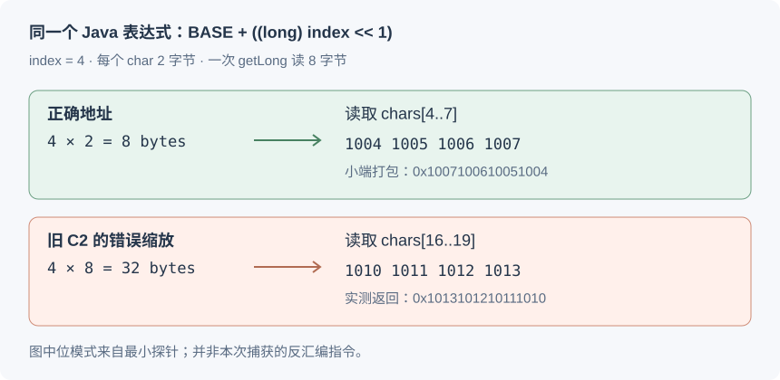
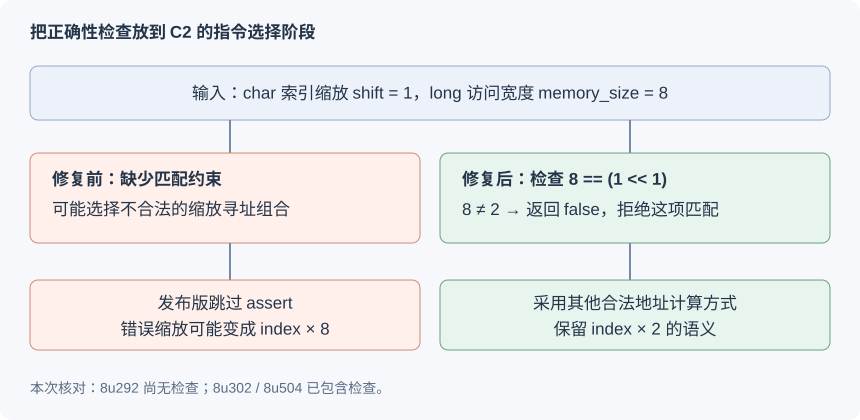

# 从 Fastjson2 解析异常追到 ARM64 JIT 编译缺陷

同一个 String，为什么开始能正常解析，反复执行后却随机报错？

这篇文章记录我排查 Fastjson2 2.0.61 一次解析异常的过程：先从输入、线程和平台差异寻找线索，再逐步验证 JIT 猜测、缩小复现，最后对照 OpenJDK 源码与补丁解释根因，并确定短期和长期处理方案。

## 1. 现象：数据没变，解析结果却变了

我在使用 Fastjson2 2.0.61 解析 JSON 时，遇到了一个奇怪的问题：同样的代码在 Windows x86 上可以稳定运行，到了 ARM Linux 上，反复执行一段时间后却会随机报错。

Json字符串：
```json
{"messageId":"test-123","message":["consumer://service/path?key=value"]}
```
报错信息：
```text
invalid escape character EOI
offset 641, character ]
offset 64, character "
```

我检查了测试条件：JSON 本身合法，测试只有一个线程，输入始终是同一个 String，没有任何修改。异常位置却不固定，有时像是字符串没有结束，有时又像是数组或引号的位置出了问题。

更奇怪的是，它并非一开始就失败：前面可以正常解析，反复执行一段时间后，才开始随机报错。同一份输入、同一条调用路径，为什么结果会在运行过程中发生变化？

## 2. 根据线索提出猜测，逐步缩小范围

### 2.1 从输入、线程和平台差异开始排除

看到 `invalid escape character EOI`，我最先想到的是 JSON 内容有问题，特别是字符串中的转义字符。但如果输入本身不合法，很难解释同一个 String 为什么先能连续成功，随后才报错，而且异常位置还会变化。

我也考虑过并发修改输入或共享状态。但这个复现只有一个线程，输入 String 没有变化；至少在这段最小场景中，没有找到支持这一猜测的证据。

Windows x86 正常、ARM Linux 异常，则提示我继续关注平台相关的实现。不过，这时操作系统、CPU 架构和 JDK 构建都有差异，还不能直接认定 ARM 指令或 JVM 有问题。

### 2.2 为什么开始怀疑 JIT？

最有指向性的线索是：**开始正常，执行一段时间后才出错。** 这让我怀疑，变化的也许是执行这段代码的方式。

在 HotSpot 默认的混合执行模式下，方法可以先解释执行；随着调用次数或循环次数增加，热点代码可能被编译，并进一步进入 C2 优化。如果问题只出现在某个编译版本中，就能解释为什么预热前正常、预热后失败。

这时 JIT 只是一个待验证的猜测。我先加入 `-Xint`，让程序使用解释执行，结果连续循环解析恢复正常。输入与业务代码没变，改变执行模式后现象消失，值得继续沿编译路径调查。但单凭这一组结果，还不能判断是哪一个方法、哪一级编译出了问题。

### 2.3 从异常堆栈追到两个底层方法

排查不能只停留在异常消息，我还需要沿堆栈找到具体执行路径。下面是我后续在 ARM64 Linux 容器、BellSoft 8u202 上复现时保留的一条完整异常堆栈：

```text
Exception in thread "main" com.alibaba.fastjson2.JSONException: invalid escape character EOI, offset 14, character ", line 1, column 14, fastjson-version 2.0.61 {"messageId":"test-123","message":["consumer://service/path?key=value"]}
	at com.alibaba.fastjson2.JSONReader.error(JSONReader.java:6630)
	at com.alibaba.fastjson2.JSONReaderUTF16.readString(JSONReaderUTF16.java:3279)
	at com.alibaba.fastjson2.JSONReader.read(JSONReader.java:3544)
	at com.alibaba.fastjson2.JSON.parse(JSON.java:138)
	at JsonOnlyProbe.main(JsonOnlyProbe.java:18)
```

从下往上看，调用经过 `JsonOnlyProbe.main`、`JSON.parse`、`JSONReader.read`，最后在 `JSONReaderUTF16.readString` 中抛出异常。因此，我先从 **`readString`** 的实现查起。

我对照 Fastjson2 2.0.61 的源码，看到 `readString` 的第 3279 行是在扫描到输入末尾后抛出 `invalid escape character EOI`。再往前追它的字符串扫描循环，才找到两个关键步骤：[readString 的扫描循环](https://github.com/alibaba/fastjson2/blob/2.0.61/core/src/main/java/com/alibaba/fastjson2/JSONReaderUTF16.java#L3231-L3248)。

```text
JSON.parse
  → JSONReader.read
    → JSONReaderUTF16.readString
        先调用 IOUtils.getLongLE(chars, offset)：读取 4 个 UTF16 代码单元
        再调用 containsSlashOrQuoteUTF16(v, quoteV)：判断是否有引号或反斜杠
        持续扫描，后续发现到达输入末尾时抛出异常
```

上面这段是我沿源码整理的执行关系，不是另一份异常堆栈。`getLongLE` 和 `containsSlashOrQuoteUTF16` 在前面的扫描步骤中已经返回，所以不会因为参与过计算，就一定出现在后续抛出的异常栈里。我要检查的是：它们有没有在更早的步骤读错数据，导致 `readString` 后来才发现异常。

沿着扫描循环找到 `getLongLE` 后，我继续看了 Fastjson2 2.0.61 的源码。`IOUtils` 中有 `byte[]` 和 `char[]` 两个同名重载，UTF16 字符串扫描涉及的是后者，其完整方法如下：

```java
public static long getLongLE(char[] buf, int offset) {
    long v = UNSAFE.getLong(buf, ARRAY_CHAR_BASE_OFFSET + ((long) offset << 1));
    if (BIG_ENDIAN) {
        v = Long.reverseBytes(v);
    }
    return v;
}
```

[Fastjson2 2.0.61：IOUtils.java](https://github.com/alibaba/fastjson2/blob/2.0.61/core/src/main/java/com/alibaba/fastjson2/util/IOUtils.java#L2788-L2794)。

`LE` 表示 Little Endian，即小端顺序。这个方法读取的是数组中的原始位模式，并非把 JSON 里的数字文本转成 `long`。

- Java 的一个 `char` 占 2 字节，字符下标转换为字节偏移时需要乘 2，也就是 `offset << 1`。
- `ARRAY_CHAR_BASE_OFFSET` 是数组第一个元素相对对象起点的偏移，不是一个需要硬编码的常数。
- `Unsafe.getLong` 一次读取 8 字节，因此一次可以装入 4 个 UTF16 代码单元。
- 大端机器还需要调整字节顺序；本文实验使用小端 AArch64。

Fastjson2 随后通过位运算，判断这 4 个代码单元中是否包含引号或反斜杠；如果没有，就跳过这 4 个位置继续扫描。这里的 `containsSlashOrQuoteUTF16` 与 `getLongLE` 配合，减少逐字符检查。[UTF16 扫描路径](https://github.com/alibaba/fastjson2/blob/2.0.61/core/src/main/java/com/alibaba/fastjson2/JSONReaderUTF16.java#L3231-L3248)。

如果底层读取了错误地址，扫描器就可能漏掉结束引号，或者把其他位置的数据当作当前字符串。最后抛出的异常仍然是 JSON 异常，真正出错的位置却可能在更早的内存读取步骤。

### 2.4 用方法排除进一步缩小范围

有了这条源码路径，我打开 `-XX:+PrintCompilation`，确认两个方法都参与了热点编译，再分别做排除对照：先排除 `containsSlashOrQuoteUTF16` 的编译，异常仍然存在；再排除 `IOUtils.getLongLE`，循环解析恢复正常。

这让我把注意力集中到 `getLongLE` 相关的编译路径：扫描器报告的 JSON 错误，会不会是更早的一次批量读取出错所造成的？接下来需要验证两个问题：这种行为是否随 JDK 版本变化，以及离开 Fastjson 后能否单独复现读取错误。

## 3. 对照验证：错误是否跟着 JIT 和 JDK 版本变化？

### 3.1 保持输入和程序一致，比较不同 JDK

为了验证不同 JDK 版本的行为，我在自己的 ARM64 Mac 上，通过 Colima / Apple Virtualization Framework 启动 ARM64 Linux 虚拟机，再运行 `linux/arm64` 容器。这样执行的是原生 ARM64 指令。

| 项目 | 本次配置 |
| --- | --- |
| Linux 容器用户空间 | Ubuntu 22.04.5 LTS |
| CPU 架构 | `aarch64` |
| Fastjson2 | Maven Central 的 2.0.61 JAR |
| 旧版本 | BellSoft OpenJDK 8u202-b08、8u292-b10 |
| 修复边界版本 | BellSoft OpenJDK 8u302-b08 |
| 新版对照 | Temurin OpenJDK 8u504-b01 |

我从 BellSoft 官方 GitHub Releases 下载旧 JRE，挂载到同一基础容器中，并显式调用它自己的 `bin/java`，同时检查完整版本输出，确认每一组实验实际运行的 JRE。

我让各组测试使用同一份 Java 8 字节码，构造了短 URL、长 URL、中文及转义字符三个样例。每个样例内反复解析同一个 String，并将结果与首次解析结果比较，同时检查异常和解析结果是否变化。

首个样例只有 72 个字符：

```json
{"messageId":"test-123","message":["consumer://service/path?key=value"]}
```

这次实际测试了 8u202、8u292、8u302 和 8u504。容器对照与最初遇到问题的机器分别记录。

容器可以帮助控制 Linux 用户空间与 JRE，但 CPU 仍是宿主机的 ARM CPU。

### 3.2 对比默认 JIT、解释执行和 C1

我先用 Temurin 8u504 测试，默认 JIT 累计完成 3900 万次 JSON 解析，没有出现异常。我又检查了编译日志，确认相关方法已经进入第 4 级编译，这次通过并不是因为方法还没预热。

换成 BellSoft 8u202 后，我很快看到了差异：直接校验 `getLongLE` 的测试先报出返回值不匹配。为了继续观察 JSON 解析，我又单独运行了不经过这段校验预热的 `JsonOnlyProbe`。

最近一轮三个独立进程的结果如下。循环下标从 0 开始，失败时刻随编译时机变化，不是稳定的次数阈值。

| 默认 JIT 进程 | 失败时循环下标 | 异常 |
| --- | ---: | --- |
| 第 1 次 | 635 | `offset 39, character n` |
| 第 2 次 | 34611 | `invalid escape character EOI, offset 14` |
| 第 3 次 | 37488 | `invalid escape character EOI, offset 14` |

接下来，我保持输入和程序一致，只调整 JVM 的运行模式：

| BellSoft 8u202 运行模式 | 实测结果 |
| --- | --- |
| 默认分层编译 | 三个进程全部失败 |
| `-Xint` | 三个样例合计 30 万次，通过 |
| 排除 `IOUtils.getLongLE` 编译 | 三个样例合计 300 万次，通过 |
| `-XX:TieredStopAtLevel=1` | 三个样例合计 300 万次，通过 |

`-Xint` 使用解释执行；`TieredStopAtLevel=1` 保留基础 C1 编译，同时阻止进入 C2。再结合第 4 级编译日志，调查范围进一步缩小到旧 JDK 的 C2 优化路径。

注意，不能只因方法出现在 `PrintCompilation` 日志中，就认定它有问题。这里有默认运行失败、解释执行通过、C1 通过、排除特定方法编译通过，以及后面的独立读取校验，证据才逐步形成闭环。

### 3.3 用 `-Xcomp` 主动验证编译路径

前面的现象是“执行一段时间后才出错”。为了继续验证 JIT 这个方向，我又做了一个反向实验：手动加入 `-Xcomp`，请求 JVM 在方法首次调用时就编译，观察错误是否会更早出现，而不再等待通常的热点预热过程。

```sh
java -Xcomp -Xms128m -Xmx512m \
  -cp .:fastjson2-2.0.61.jar JsonOnlyProbe 1000000
```

这个参数的含义见 [Java 8 启动参数说明](https://docs.oracle.com/javase/8/docs/technotes/tools/unix/java.html)。这里我改变的是编译执行方式，JSON、Fastjson2 版本和测试程序都保持一致。

结果，在 BellSoft 8u202 上，程序还没进入循环，就在用于建立参考结果的第一次 `JSON.parse` 调用中失败了。完整异常如下：

```text
Exception in thread "main" com.alibaba.fastjson2.JSONException: offset 29, character s, line 1, column 29, fastjson-version 2.0.61 {"messageId":"test-123","message":["consumer://service/path?key=value"]}
	at com.alibaba.fastjson2.JSONReader.read(JSONReader.java:3459)
	at com.alibaba.fastjson2.JSON.parse(JSON.java:138)
	at JsonOnlyProbe.main(JsonOnlyProbe.java:15)
```

我也在 8u504 上运行同样的解析测试，进行对照：

| `-Xcomp` 实验 | BellSoft 8u202 | Temurin 8u504 |
| --- | --- | --- |
| `JsonOnlyProbe` | 首次 `JSON.parse` 即报错，尚未进入循环 | 三个样例合计 300 万次通过 |

这组结果与前面的现象对上了：默认模式下，错误在预热后出现；解释执行时通过；主动请求编译后，旧 JDK 更早出错。它进一步支持了我继续检查 JIT 编译路径的方向。具体是哪一步把地址算错，还需要下一步的独立探针和源码分析。

## 4. 缩小复现：去掉 Fastjson，读取仍然出错

为了判断 Fastjson 的扫描逻辑是否参与了错误，我继续缩小复现：构造一个带位置标记的 `char[]`，第 `i` 个元素写入 `0x1000 + i`，然后反复从下标 4 读取 8 字节。这个程序完全不依赖 Fastjson。

下面是可直接保存为 `UnsafeScaleProbe.java` 的完整程序：

```java
import sun.misc.Unsafe;
import java.lang.reflect.Field;

public class UnsafeScaleProbe {
    static final Unsafe U;
    static final long BASE;
    static volatile long sink;

    static {
        try {
            Field f = Unsafe.class.getDeclaredField("theUnsafe");
            f.setAccessible(true);
            U = (Unsafe) f.get(null);
            BASE = U.arrayBaseOffset(char[].class);
        } catch (Exception e) {
            throw new RuntimeException(e);
        }
    }

    public static long read(char[] chars, int index) {
        return U.getLong(chars, BASE + ((long) index << 1));
    }

    public static void main(String[] args) {
        char[] chars = new char[4096];
        for (int i = 0; i < chars.length; i++) {
            chars[i] = (char) (0x1000 + i);
        }
        int index = 4;
        long expected = 0x1007100610051004L;
        System.out.println("java=" + System.getProperty("java.runtime.version")
                + " charBase=" + BASE);
        for (int i = 0; i < 1000000; i++) {
            long actual = read(chars, index);
            if (actual != expected) {
                System.out.printf(
                        "FAIL iteration=%d index=%d expected=0x%016x "
                        + "actual=0x%016x actualFirstCharIndex=%d%n",
                        i, index, expected, actual, (actual & 65535) - 0x1000);
                System.exit(1);
            }
            sink = actual;
        }
        System.out.println("PASS reads=1000000 expected=0x1007100610051004");
    }
}
```

程序按本文的小端环境设置参考值，`sink` 用于保留读取结果的可观察使用。运行时只允许 `read` 编译，让调用方保持解释执行，减少调用方优化带来的干扰：

```sh
javac -source 8 -target 8 UnsafeScaleProbe.java
java -Xbatch \
  '-XX:CompileCommand=compileonly,UnsafeScaleProbe::read' \
  '-XX:CompileCommand=print,UnsafeScaleProbe::read' \
  -cp . UnsafeScaleProbe
```

在 8u202 上，日志记录 `read` 先进入 C1，再进入 C2，随后出现：

```text
FAIL iteration=5376 index=4
expected=0x1007100610051004
actual=0x1013101210111010
actualFirstCharIndex=16
```

预期读取的是 `chars[4..7]`，实际读取的是 `chars[16..19]`。同一个探针在 8u504 的 C2 编译后运行 100 万次通过。

我还对这个独立探针补做了 `-Xcomp` 实验：8u202 在循环下标 1 就出现相同的读取偏移，8u504 则完成 100 万次读取。主动请求编译后，离开 Fastjson 仍会更早出现同一种错误。



这个实验把“随机 JSON 错误”转化成了更具体的事实：**一次合法范围内的读取，在 C2 编译后使用了错误的地址。** 它还证明，复现这个错误不需要 Fastjson 参与。

## 5. 定位根因：C2 为什么把 ×2 变成 ×8？

带着“下标 4 为什么读成下标 16”这个问题，我查到了与现象对应的上游缺陷 [JDK-8267689](https://bugs.openjdk.org/browse/JDK-8267689)，标题为“[8u] [aarch64] Crash due to bad shift in indirect addressing mode”。[OpenJDK 8 修复提交](https://github.com/openjdk/jdk8u/commit/3c41cd8e624173834fa7b9ee8ede148c4e5541d0) 修改的是 AArch64 的 C2 机器描述文件：

```text
hotspot/src/cpu/aarch64/vm/aarch64.ad
```

### 5.1 一个表达式中有两个尺寸

`Unsafe.getLong(chars, BASE + ((long) index << 1))` 包含两件不同的事：

1. 按字符下标定位：`index × 2`。
2. 从定位后的地址读取：8 字节。

普通的数组元素读取中，元素步长与访存宽度通常相同；`Unsafe` 的跨类型批量读取打破了这种对应关系。

AArch64 的这种寄存器偏移寻址形式，不能给 64 位加载随意指定一个缩放量。对本例，它可以不缩放，也可以按 8 字节缩放；**不能把需要 `×2` 的地址计算直接塞进按访问宽度缩放的 64 位加载指令里。**

### 5.2 旧指令匹配缺少约束

旧版 `aarch64.ad` 中，`indIndexScaledI2L` 等 operand 能匹配带左移的地址表达式，却没有验证移位量是否与后续的内存访问宽度一致。

继续看 [Address 编码分支](https://github.com/openjdk/jdk8u/blob/0f8c1b4/hotspot/src/cpu/aarch64/vm/assembler_aarch64.hpp#L464-L483)：它先用 `assert` 检查非零移位量是否与访问尺寸相符，再将“是否需要缩放”编码到指令的一个比特中。对 64 位加载，这个比特代表按 8 字节缩放。

调试构建可能触发 `bad shift` 断言；发布构建没有这项运行时断言，错误匹配就可能继续生成机器码。Java 需要的地址是：

```text
数组元素起点 + index × 2
```

实际效果却成了：

```text
数组元素起点 + index × 8
```

这正好解释了为什么下标 4 会读到下标 16。`byte[]` 的无缩放索引则不需要这一非零移位量，因此两个同名重载也可能表现不同。

这里的指令行为分析来自源码与最小探针返回值。实验环境没有安装 hsdis，日志只确认了 C1/C2 编译，**本文没有把示意指令冒充为本次直接捕获的反汇编结果**。

## 6. 找到补丁：拒绝不相容的地址缩放

JDK-8267689 在 `aarch64.ad` 中新增 `size_fits_all_mem_uses`。以下是该修复提交中的完整函数：

```cpp
bool size_fits_all_mem_uses(AddPNode* addp, int shift) {
  for (DUIterator_Fast imax, i = addp->fast_outs(imax); i < imax; i++) {
    Node* u = addp->fast_out(i);
    if (u->is_Mem()) {
      int opsize = u->as_Mem()->memory_size();
      assert(opsize > 0, "unexpected memory operand size");
      if (u->as_Mem()->memory_size() != (1<<shift)) {
        return false;
      }
    }
  }
  return true;
}
```

它沿着地址节点的使用关系检查内存操作：读取或写入的字节数，必须与缩放量相容。该函数被加到多种带缩放地址的匹配条件中，例如完整的 `indIndexScaledI2L` 定义：

```cpp
operand indIndexScaledI2L(iRegP reg, iRegI ireg, immIScale scale)
%{
  predicate(size_fits_all_mem_uses(n->as_AddP(),
                                   n->in(AddPNode::Offset)->in(2)->get_int()));
  constraint(ALLOC_IN_RC(ptr_reg));
  match(AddP reg (LShiftL (ConvI2L ireg) scale));
  op_cost(0);
  format %{ "$reg, $ireg sxtw($scale), 0, I2L" %}
  interface(MEMORY_INTER) %{
    base($reg);
    index($ireg);
    scale($scale);
    disp(0x0);
  %}
%}
```

[固定提交中的完整检查函数](https://github.com/openjdk/jdk8u/blob/3c41cd8e624173834fa7b9ee8ede148c4e5541d0/hotspot/src/cpu/aarch64/vm/aarch64.ad#L2167-L2179)；operand 的新增条件见同一份[补丁差异](https://github.com/openjdk/jdk8u/commit/3c41cd8e624173834fa7b9ee8ede148c4e5541d0)。

代入 Fastjson2 的场景：`memory_size = 8`，而 `shift = 1`，所以 `8 != (1 << 1)`。检查返回 `false`，C2 拒绝使用这项错误的寻址匹配，转而选择能正确表达地址的其他指令组合。



在 8u504 的源码中可以看到这项检查，另外还有后续针对 CAS 使用者的保护；普通 `getLong` 场景对应的主要修复是 JDK-8267689。

## 7. 验证根因：修复前后的版本是否符合预期？

查到补丁后，我还想验证它是否与这次问题对应。前面的 8u202 与 8u504 使用了不同发行商，因此我又下载同为 BellSoft 的 ARM64 Linux 8u292-b10 和 8u302-b08，在同一个容器里运行同一份字节码。

| 测试 | BellSoft 8u292-b10 | BellSoft 8u302-b08 |
| --- | --- | --- |
| 无 Fastjson 的地址缩放探针 | C2 后失败，`chars[4]` 读成 `chars[16]` | C2 后 100 万次通过 |
| `getLongLE(char[])` 独立校验 | 第 26550 下标失败 | 1000 万次通过 |
| Fastjson2 2.0.61 解析 | 第 35971 下标报 EOI 异常 | 三个样例合计 300 万次通过 |

源码标签也给出一致的边界：

- `jdk8u292-b10`：尚无 `size_fits_all_mem_uses` 检查。
- `jdk8u302-b08`：已有该检查。
- `jdk8u504-b01`：保留该检查。

JBS 的 `fixVersions` 标注为 `openjdk8u302`，[BellSoft 8u302+8 发布说明](https://docs.bell-sw.com/liberica-jdk/8u302b8/general/release-notes/) 也列出了 JDK-8267689。因此，8u504 通过的解释是：**它已包含这一更早合入的修复。**

官方机制、补丁逻辑、独立探针和版本边界相互吻合，足以将此次现象对应到该修复。不过，本次没有把同一个 JVM 源码基线只增删这一补丁后重新构建，也就不声称完成了单补丁的二进制因果隔离。实测边界同样不能直接等同于所有厂商构建的边界。

## 8. 串起故障链：为什么最终表现为 JSON 随机异常？

回头看，最初那些看似零散的现象，其实可以用同一条故障链解释：

```text
固定 JSON，开始可以正常解析
  → 热点代码进入旧版 AArch64 C2 编译路径
  → char 下标 ×2 的地址表达式被错误匹配到按 ×8 缩放的访存
  → getLongLE 读到其他位置的字符
  → 字符串扫描器误判引号或反斜杠的位置
  → 后续解析抛出 JSON 异常
```

**为什么看起来是随机报错？** 错误地址计算有明确的规律，但是否进入相关编译版本、在第几次调用进入，会受到编译时机影响；读到错误位置后，解析器最终在哪个位置发现不合法，也取决于那里的数据。因此，失败次数和异常 offset 可以变化，背后却是同一种地址缩放错误。

**为什么 `-Xint`、只保留 C1 或排除 `getLongLE` 后正常？** 这些对照分别避开了已定位的 C2 编译路径。反过来，主动加上 `-Xcomp` 后，8u202 在首次解析时就失败，与“错误随编译路径出现”的判断一致。

**为什么异常在 Fastjson 中抛出，根因却落到 JVM？** Fastjson 的字符串扫描依赖底层读取结果。独立探针去掉全部 JSON 解析逻辑后，仍能稳定观测到 `chars[4]` 读成 `chars[16]`；再结合 OpenJDK 指令匹配缺陷、修复内容和 8u292 / 8u302 的版本边界，才能把问题对应到 JDK-8267689。

**为什么 8u504 没问题？** 它已经包含 8u302 合入的这项修复，拒绝将字符步长与 8 字节访存宽度错误地合并。这里关键的是目标 JDK 是否包含修复，而不只是“新版本跑得更久”。

排查到这里，我才有足够依据决定如何处理：短期绕开触发缺陷的编译路径，长期换到包含修复并完成业务回归的 JDK。

## 9. 解决方案：短期绕过与长期修复

### 9.1 短期：排除相关方法编译，恢复解析

我最初用来恢复解析、并在后续实验中再次验证有效的临时参数是：

```sh
'-XX:CompileCommand=exclude,com.alibaba.fastjson2.util.IOUtils::getLongLE'
```

没有指定方法签名时，该规则会覆盖同名重载。本次组合校验的日志确认，`char[]` 和 `byte[]` 两个重载都被排除。不要只检查启动参数是否存在，还要检查 JVM 是否实际识别了规则，并运行原始输入的回归。

这是临时规避手段，**性能代价需要压测**。本文普通组合校验的测试主体，默认 JIT 约 0.9 秒，排除组约 11 秒；其中包含大量直接 `getLongLE` 调用，不能据此推算线上接口降速比例，也不能无依据地说“影响极小”。`-Xint` 的测试次数更少，耗时不能与这些组直接比较。

### 9.2 长期：升级到包含修复的 JDK，并完成回归

长期方案是升级或更换到明确包含 JDK-8267689 或等价修复的 JDK 构建。对实际机器先收集完整 `java -version`、JVM 名称、CPU 架构及型号，再向发行商确认 JDK-8267689 或等价修复是否合入。在包含修复的目标 JDK 上，使用原始 JSON 和业务测试完成回归，然后评估移除临时排除参数。

本文验证了 BellSoft 8u302 与 Temurin 8u504 的具体构建；“版本号更大”本身不能证明任意国产 JDK 已有相同补丁。只升级 Fastjson2 可能改变优化路径，但也不能替代对 JVM 根因的确认。

回归时，我会保留原始 JSON、完整异常栈和独立探针，分别检查解析结果、相关方法进入编译后的行为，以及移除临时参数后的稳定性与性能。解释执行和限制到 C1 的结果可以作为诊断依据；本次已经验证的针对性短期绕过是上面的 `getLongLE` 排除规则。

## 10. 复现资料与参考来源

[复现源码与证据说明](../assets/fastjson2-arm64-jit/evidence/README.md)：包含三类 Java 探针及辅助源码、运行脚本、关键原始日志、版本边界结果与文件校验清单。包内不附带 JRE 或 Fastjson JAR；运行方式与依赖下载地址见 README。源码与日志反映的是本文已执行的实验，读者在自己的机器上可能遇到不同的编译时机。

| 来源 | 用途 |
| --- | --- |
| [Fastjson2 2.0.61 IOUtils](https://github.com/alibaba/fastjson2/blob/2.0.61/core/src/main/java/com/alibaba/fastjson2/util/IOUtils.java#L2774-L2794) | `getLongLE` 两个重载 |
| [Fastjson2 2.0.61 JSONReaderUTF16](https://github.com/alibaba/fastjson2/blob/2.0.61/core/src/main/java/com/alibaba/fastjson2/JSONReaderUTF16.java#L3231-L3248) | 读取 4 个代码单元后的扫描路径 |
| [JDK-8267689](https://bugs.openjdk.org/browse/JDK-8267689) | 官方缺陷与修复版本记录 |
| [OpenJDK 修复提交 3c41cd8](https://github.com/openjdk/jdk8u/commit/3c41cd8e624173834fa7b9ee8ede148c4e5541d0) | 检查函数及指令匹配条件 |
| [修复前的 Address 编码](https://github.com/openjdk/jdk8u/blob/0f8c1b4/hotspot/src/cpu/aarch64/vm/assembler_aarch64.hpp#L464-L483) | 调试断言与缩放位编码 |
| [8u292 源码标签](https://github.com/openjdk/jdk8u/blob/jdk8u292-b10/hotspot/src/cpu/aarch64/vm/aarch64.ad) / [8u302 源码标签](https://github.com/openjdk/jdk8u/blob/jdk8u302-b08/hotspot/src/cpu/aarch64/vm/aarch64.ad) / [8u504 源码标签](https://github.com/openjdk/jdk8u/blob/jdk8u504-b01/hotspot/src/cpu/aarch64/vm/aarch64.ad) | 核对补丁是否存在 |
| [BellSoft 8u302+8 发布说明](https://docs.bell-sw.com/liberica-jdk/8u302b8/general/release-notes/) | 发行版修复清单 |
| [Apache Fory PR #4049](https://github.com/apache/fory/pull/4049) | 相同 Unsafe 地址缩放机制的旁证，不替代本文实测 |

继续阅读：[JIT 即时编译、JMM 与内存屏障](../jit-jmm-memory-barriers/)、[JDK 源码手册](../../jdk-source/)、[JVM 学习手册](../../jvm/)。
