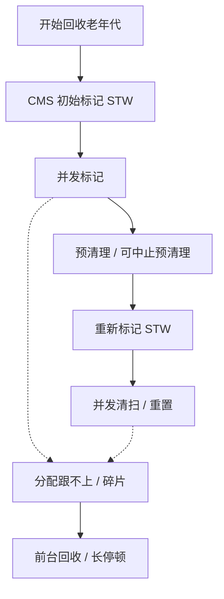
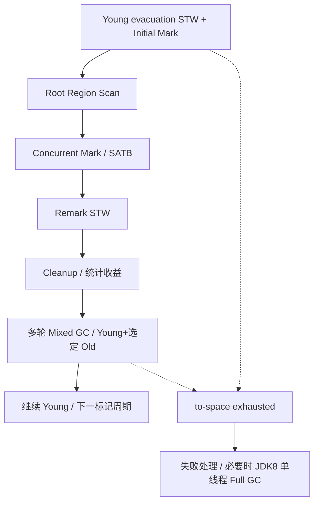

# JVM 内存管理、CMS 与 G1

本章限定 HotSpot 8u462-b08。JDK 8 服务端通常默认使用 Parallel GC；以下 CMS 和 G1 的流程，需要按实际启动参数选择。尤其注意：这里的 G1 Full GC 仍是单线程实现。

## 核心知识与原理

### 内存、对象分配与安全点

一次请求创建了很多临时对象，请求结束后却不一定立即释放内存。Java 不在对象离开方法时逐个 free，而是在 GC 时判断它们还能不能被访问到。理解这一点，就能区分“还没回收”和“始终回收不掉”。

对象主要在堆中。线程栈保存方法执行需要的局部变量、返回信息等，每个线程有自己的栈；程序计数器和本地方法栈也与线程有关。JDK 8 的类元数据主要放在本地内存中的 Metaspace，字符串对象仍在堆里。方法区是 JVM 规范中的概念，不能把它和某一块具体内存简单画等号。

普通小对象常在 Eden 分配。为了避免每个线程分配时都争抢同一个指针，JVM 会给线程一小块 TLAB，让它在里面快速分配。TLAB 仍属于堆，只是暂时由该线程负责分配；里面的对象照样可以交给其他线程。空间不够时再申请 TLAB 或走慢路径。JIT 还可能通过逃逸分析和标量替换消除某些分配。

Young GC 会把存活对象移到 Survivor，或晋升到老年代。什么时候晋升既看年龄，也看 Survivor 剩余空间和具体收集器策略，因此不能只背一个固定年龄。G1 中超过半个 Region 的对象属于 Humongous，通常需要连续 Region；大数组会带来特别的空间压力。

GC 从 Roots 开始寻找可达对象，例如线程栈中的引用、JNI handle 和活跃类相关引用。两个对象互相引用，但没有任何 Roots 能到达它们，仍可一起回收。为了准确读取线程状态，JVM 需要让线程到达安全点。一次长停顿既可能花在回收工作上，也可能花在等待线程到达安全点上，日志分析时要分清。

### CMS：并发并不意味着无停顿

CMS 主要处理老年代，年轻代通常搭配 ParNew。它希望把大部分工作与应用同时执行，减少连续暂停的时间。大致过程是：暂停做初始标记，恢复应用并发标记，预清理一部分变化，再暂停做重新标记，最后并发清扫和重置。

为什么还要重新标记？因为应用在并发标记期间继续改引用：原来没有被扫描到的对象可能变得可达，已经扫描的对象也可能连上新对象。CMS 需要借助写屏障、卡信息等补齐工作，最终在重新标记时确认哪些对象不能回收。

CMS 正常周期采用标记清扫，不把所有存活对象搬到一起。清出的空间像大小不同的空隙，可能有碎片；标记期间后来才变成垃圾的一部分对象，也要留到下一轮，这叫浮动垃圾。应用仍在分配和晋升，所以不能等老年代快满了才启动。

如果并发回收来不及提供空间，就可能出现 Concurrent Mode Failure，转入前台回收，停顿明显变长。Young GC 晋升失败的 Promotion Failed 是另一种日志现象，二者可能相关，但不是同一个名称的两种写法。排查时要同时看分配速度、CMS 周期、可用空间和碎片，而不是看到 Full GC 就改一个阈值。

### G1：Region、RSet 与 SATB

G1 把堆切成等大的 Region。同一块 Region 可以在不同阶段担任 Eden、Survivor 或 Old。Young GC 暂停应用，将选中区域里的存活对象复制出去，原区域随后可以整体复用。

只回收部分 Region 时，怎么知道外面的对象还引用着里面？RSet 保存来自其他区域的引用信息，帮助 GC 找到这些入口。Card Table 用较粗的卡片粒度标记发生引用更新的位置，后台 refinement 再整理相关信息。因此 RSet 不是一张精确的全堆引用图，维护它也需要 CPU 和内存。

G1 的并发标记使用 SATB。假设 A 原来指向 B，标记开始后应用把这个引用清掉；若 GC 还没扫描到 B，就可能错过标记开始时它仍可达的事实。写前屏障会记录被覆盖的旧引用，帮助保留这份开始时的快照。记住“旧引用”比只背三色标记更能解释这段代码。

初始标记通常搭在一次 Young 停顿里，随后进行 root region scan 和并发标记，再暂停做 remark，并做 cleanup。标记结果告诉 G1 哪些 Old Region 垃圾多、回收划算。之后的 Mixed GC 同时回收 Young 和部分 Old，分几次完成，避免一次把所有 Old 都搬完。

`MaxGCPauseMillis` 是希望达到的目标。G1 根据历史扫描、复制耗时估计本次该选多少 Region，但对象存活率、RSet 大小、CPU 配额都可能改变实际成本，所以它不能保证每次严格按时结束。to-space exhausted 表示搬迁目的空间不够，失败处理会增加工作，严重时可能进入 JDK 8 的单线程 Full GC。

### CMS 与 G1 的选择

|问题|CMS（JDK 8）|G1（JDK 8）|
|---|---|---|
|老年代怎样腾空间？|并发标记后清扫空块，正常周期不整理|标记后分批选择 Region，在暂停中复制存活对象|
|主要怕什么？|回收跟不上分配、浮动垃圾、碎片|搬迁空间不足、RSet 成本、大对象占连续区域|
|该看哪些数据？|并发周期、晋升速度、重标记与失败日志|Young/Mixed 耗时、存活字节、Humongous、标记启动时间|

已有 CMS 系统是否值得换 G1，要用相同流量和数据量测试暂停、吞吐与 CPU。换收集器不会让仍被静态集合引用的对象消失；这种问题需要去看<a href="../jvm-oom-troubleshooting/">对象是谁持有的</a>。

### 回收来得及吗？算一遍新增内存

假设 CMS 一轮并发周期要 4 秒，应用每秒向老年代新增 200MB。回收完成前，应用大约还要用掉 800MB。如果启动时只剩 300MB，就很容易来不及。这个算例不能直接算出最佳参数，但能解释为什么“使用率还没到 100%”也会退化。

G1 也要给并发标记期间的增长、后续 Mixed 和下一次对象搬迁留空间。调低暂停目标可能缩小 Young、增加回收次数，单次暂停变短，总 GC CPU 却上升。每次调整都应保留 JVM 更新号、启动参数、CPU 配额和相同负载下的日志，分别比较 Young、remark、Mixed、Full GC，而不是只比较一次最长停顿。


## 源码级解析与调用链

GC 主过程在 HotSpot 的 C++ 中。CMS 看 `CMSCollector::collect_in_background` 的状态推进，再找每个暂停阶段提交的 VM operation。G1 看 `do_collection_pause_at_safepoint`，并结合 G1CollectorPolicy 的选区预测。

下面两个片段只是入口。并发标记还要看 ConcurrentMark，SATB 屏障涉及 G1SATBCardTableModRefBS。读入口时先确认哪些工作要求安全点，再追实际标记、扫描和复制；仅看 System.gc 的 Java 调用无法解释这些阶段。


<div class="source-caption"><code>CMSCollector::collect_in_background</code><span>HotSpot 8u462-b08 · L2250–L2504 · <a href="https://github.com/openjdk/jdk8u/blob/jdk8u462-b08/hotspot/src/share/vm/gc_implementation/concurrentMarkSweep/concurrentMarkSweepGeneration.cpp#L2250-L2504">完整源码</a></span></div>

```cpp
// There are separate collect_in_background and collect_in_foreground because of
// the different locking requirements of the background collector and the
// foreground collector.  There was originally an attempt to share
// one "collect" method between the background collector and the foreground
// collector but the if-then-else required made it cleaner to have
// separate methods.
void CMSCollector::collect_in_background(bool clear_all_soft_refs, GCCause::Cause cause) {
  assert(Thread::current()->is_ConcurrentGC_thread(),
    "A CMS asynchronous collection is only allowed on a CMS thread.");

  GenCollectedHeap* gch = GenCollectedHeap::heap();
  {
    bool safepoint_check = Mutex::_no_safepoint_check_flag;
    MutexLockerEx hl(Heap_lock, safepoint_check);
    FreelistLocker fll(this);
    MutexLockerEx x(CGC_lock, safepoint_check);
    if (_foregroundGCIsActive || !UseAsyncConcMarkSweepGC) {
      // The foreground collector is active or we're
      // not using asynchronous collections.  Skip this
      // background collection.
      assert(!_foregroundGCShouldWait, "Should be clear");
      return;
    } else {
      assert(_collectorState == Idling, "Should be idling before start.");
      _collectorState = InitialMarking;
      register_gc_start(cause);
      // Reset the expansion cause, now that we are about to begin
      // a new cycle.
      clear_expansion_cause();

      // Clear the MetaspaceGC flag since a concurrent collection
      // is starting but also clear it after the collection.
      MetaspaceGC::set_should_concurrent_collect(false);
    }
    // Decide if we want to enable class unloading as part of the
    // ensuing concurrent GC cycle.
    update_should_unload_classes();
    _full_gc_requested = false;           // acks all outstanding full gc requests
    _full_gc_cause = GCCause::_no_gc;
    // Signal that we are about to start a collection
    gch->increment_total_full_collections();  // ... starting a collection cycle
    _collection_count_start = gch->total_full_collections();
  }

  // Used for PrintGC
  size_t prev_used = 0;
  if (PrintGC && Verbose) {
    prev_used = _cmsGen->used(); // XXXPERM
  }

  // The change of the collection state is normally done at this level;
  // the exceptions are phases that are executed while the world is
  // stopped.  For those phases the change of state is done while the
  // world is stopped.  For baton passing purposes this allows the
  // background collector to finish the phase and change state atomically.
  // The foreground collector cannot wait on a phase that is done
  // while the world is stopped because the foreground collector already
  // has the world stopped and would deadlock.
  while (_collectorState != Idling) {
    if (TraceCMSState) {
      gclog_or_tty->print_cr("Thread " INTPTR_FORMAT " in CMS state %d",
        Thread::current(), _collectorState);
    }
    // The foreground collector
    //   holds the Heap_lock throughout its collection.
    //   holds the CMS token (but not the lock)
    //     except while it is waiting for the background collector to yield.
    //
    // The foreground collector should be blocked (not for long)
    //   if the background collector is about to start a phase
    //   executed with world stopped.  If the background
    //   collector has already started such a phase, the
    //   foreground collector is blocked waiting for the
    //   Heap_lock.  The stop-world phases (InitialMarking and FinalMarking)
    //   are executed in the VM thread.
    //
    // The locking order is
    //   PendingListLock (PLL)  -- if applicable (FinalMarking)
    //   Heap_lock  (both this & PLL locked in VM_CMS_Operation::prologue())
    //   CMS token  (claimed in
    //                stop_world_and_do() -->
    //                  safepoint_synchronize() -->
    //                    CMSThread::synchronize())

    {
      // Check if the FG collector wants us to yield.
      CMSTokenSync x(true); // is cms thread
      if (waitForForegroundGC()) {
        // We yielded to a foreground GC, nothing more to be
        // done this round.
        assert(_foregroundGCShouldWait == false, "We set it to false in "
               "waitForForegroundGC()");
        if (TraceCMSState) {
          gclog_or_tty->print_cr("CMS Thread " INTPTR_FORMAT
            " exiting collection CMS state %d",
            Thread::current(), _collectorState);
        }
        return;
      } else {
        // The background collector can run but check to see if the
        // foreground collector has done a collection while the
        // background collector was waiting to get the CGC_lock
        // above.  If yes, break so that _foregroundGCShouldWait
        // is cleared before returning.
        if (_collectorState == Idling) {
          break;
        }
      }
    }

    assert(_foregroundGCShouldWait, "Foreground collector, if active, "
      "should be waiting");

    switch (_collectorState) {
      case InitialMarking:
        {
          ReleaseForegroundGC x(this);
          stats().record_cms_begin();
          VM_CMS_Initial_Mark initial_mark_op(this);
          VMThread::execute(&initial_mark_op);
        }
        // The collector state may be any legal state at this point
        // since the background collector may have yielded to the
        // foreground collector.
        break;
      case Marking:
        // initial marking in checkpointRootsInitialWork has been completed
        if (markFromRoots(true)) { // we were successful
          assert(_collectorState == Precleaning, "Collector state should "
            "have changed");
        } else {
          assert(_foregroundGCIsActive, "Internal state inconsistency");
        }
        break;
      case Precleaning:
        if (UseAdaptiveSizePolicy) {
          size_policy()->concurrent_precleaning_begin();
        }
        // marking from roots in markFromRoots has been completed
        preclean();
        if (UseAdaptiveSizePolicy) {
          size_policy()->concurrent_precleaning_end();
        }
        assert(_collectorState == AbortablePreclean ||
               _collectorState == FinalMarking,
               "Collector state should have changed");
        break;
      case AbortablePreclean:
        if (UseAdaptiveSizePolicy) {
        size_policy()->concurrent_phases_resume();
        }
        abortable_preclean();
        if (UseAdaptiveSizePolicy) {
          size_policy()->concurrent_precleaning_end();
        }
        assert(_collectorState == FinalMarking, "Collector state should "
          "have changed");
        break;
      case FinalMarking:
        {
          ReleaseForegroundGC x(this);

          VM_CMS_Final_Remark final_remark_op(this);
          VMThread::execute(&final_remark_op);
        }
        assert(_foregroundGCShouldWait, "block post-condition");
        break;
      case Sweeping:
        if (UseAdaptiveSizePolicy) {
          size_policy()->concurrent_sweeping_begin();
        }
        // final marking in checkpointRootsFinal has been completed
        sweep(true);
        assert(_collectorState == Resizing, "Collector state change "
          "to Resizing must be done under the free_list_lock");
        _full_gcs_since_conc_gc = 0;

        // Stop the timers for adaptive size policy for the concurrent phases
        if (UseAdaptiveSizePolicy) {
          size_policy()->concurrent_sweeping_end();
          size_policy()->concurrent_phases_end(gch->gc_cause(),
                                             gch->prev_gen(_cmsGen)->capacity(),
                                             _cmsGen->free());
        }

      case Resizing: {
        // Sweeping has been completed...
        // At this point the background collection has completed.
        // Don't move the call to compute_new_size() down
        // into code that might be executed if the background
        // collection was preempted.
        {
          ReleaseForegroundGC x(this);   // unblock FG collection
          MutexLockerEx       y(Heap_lock, Mutex::_no_safepoint_check_flag);
          CMSTokenSync        z(true);   // not strictly needed.
          if (_collectorState == Resizing) {
            compute_new_size();
            save_heap_summary();
            _collectorState = Resetting;
          } else {
            assert(_collectorState == Idling, "The state should only change"
                   " because the foreground collector has finished the collection");
          }
        }
        break;
      }
      case Resetting:
        // CMS heap resizing has been completed
        reset(true);
        assert(_collectorState == Idling, "Collector state should "
          "have changed");

        MetaspaceGC::set_should_concurrent_collect(false);

        stats().record_cms_end();
        // Don't move the concurrent_phases_end() and compute_new_size()
        // calls to here because a preempted background collection
        // has it's state set to "Resetting".
        break;
      case Idling:
      default:
        ShouldNotReachHere();
        break;
    }
    if (TraceCMSState) {
      gclog_or_tty->print_cr("  Thread " INTPTR_FORMAT " done - next CMS state %d",
        Thread::current(), _collectorState);
    }
    assert(_foregroundGCShouldWait, "block post-condition");
  }

  // Should this be in gc_epilogue?
  collector_policy()->counters()->update_counters();

  {
    // Clear _foregroundGCShouldWait and, in the event that the
    // foreground collector is waiting, notify it, before
    // returning.
    MutexLockerEx x(CGC_lock, Mutex::_no_safepoint_check_flag);
    _foregroundGCShouldWait = false;
    if (_foregroundGCIsActive) {
      CGC_lock->notify();
    }
    assert(!ConcurrentMarkSweepThread::cms_thread_has_cms_token(),
           "Possible deadlock");
  }
  if (TraceCMSState) {
    gclog_or_tty->print_cr("CMS Thread " INTPTR_FORMAT
      " exiting collection CMS state %d",
      Thread::current(), _collectorState);
  }
  if (PrintGC && Verbose) {
    _cmsGen->print_heap_change(prev_used);
  }
}

```

入口先串行协调一次 CMS 周期，并准备老年代相关状态。真正分阶段的工作在后续状态循环中；这个片段不能单独证明所有阶段都没有停顿，要继续读 InitialMarking 和 FinalMarking 的 VM 操作。


<div class="source-caption"><code>G1CollectedHeap::do_collection_pause_at_safepoint</code><span>HotSpot 8u462-b08 · L3972–L4381 · <a href="https://github.com/openjdk/jdk8u/blob/jdk8u462-b08/hotspot/src/share/vm/gc_implementation/g1/g1CollectedHeap.cpp#L3972-L4381">完整源码</a></span></div>

```cpp
bool
G1CollectedHeap::do_collection_pause_at_safepoint(double target_pause_time_ms) {
  assert_at_safepoint(true /* should_be_vm_thread */);
  guarantee(!is_gc_active(), "collection is not reentrant");

  if (GC_locker::check_active_before_gc()) {
    return false;
  }

  _gc_timer_stw->register_gc_start();

  _gc_tracer_stw->report_gc_start(gc_cause(), _gc_timer_stw->gc_start());

  SvcGCMarker sgcm(SvcGCMarker::MINOR);
  ResourceMark rm;

  print_heap_before_gc();
  trace_heap_before_gc(_gc_tracer_stw);

  verify_region_sets_optional();
  verify_dirty_young_regions();

  // This call will decide whether this pause is an initial-mark
  // pause. If it is, during_initial_mark_pause() will return true
  // for the duration of this pause.
  g1_policy()->decide_on_conc_mark_initiation();

  // We do not allow initial-mark to be piggy-backed on a mixed GC.
  assert(!g1_policy()->during_initial_mark_pause() ||
          g1_policy()->gcs_are_young(), "sanity");

  // We also do not allow mixed GCs during marking.
  assert(!mark_in_progress() || g1_policy()->gcs_are_young(), "sanity");

  // Record whether this pause is an initial mark. When the current
  // thread has completed its logging output and it's safe to signal
  // the CM thread, the flag's value in the policy has been reset.
  bool should_start_conc_mark = g1_policy()->during_initial_mark_pause();

  // Inner scope for scope based logging, timers, and stats collection
  {
    EvacuationInfo evacuation_info;

    if (g1_policy()->during_initial_mark_pause()) {
      // We are about to start a marking cycle, so we increment the
      // full collection counter.
      increment_old_marking_cycles_started();
      register_concurrent_cycle_start(_gc_timer_stw->gc_start());
    }

    _gc_tracer_stw->report_yc_type(yc_type());

    TraceCPUTime tcpu(G1Log::finer(), true, gclog_or_tty);

    uint active_workers = AdaptiveSizePolicy::calc_active_workers(workers()->total_workers(),
                                                                  workers()->active_workers(),
                                                                  Threads::number_of_non_daemon_threads());
    assert(UseDynamicNumberOfGCThreads ||
           active_workers == workers()->total_workers(),
           "If not dynamic should be using all the  workers");
    workers()->set_active_workers(active_workers);


    double pause_start_sec = os::elapsedTime();
    g1_policy()->phase_times()->note_gc_start(active_workers, mark_in_progress());
    log_gc_header();

    TraceCollectorStats tcs(g1mm()->incremental_collection_counters());
    TraceMemoryManagerStats tms(false /* fullGC */, gc_cause(),
                                yc_type() == Mixed /* allMemoryPoolsAffected */);

    // If the secondary_free_list is not empty, append it to the
    // free_list. No need to wait for the cleanup operation to finish;
    // the region allocation code will check the secondary_free_list
    // and wait if necessary. If the G1StressConcRegionFreeing flag is
    // set, skip this step so that the region allocation code has to
    // get entries from the secondary_free_list.
    if (!G1StressConcRegionFreeing) {
      append_secondary_free_list_if_not_empty_with_lock();
    }

    assert(check_young_list_well_formed(), "young list should be well formed");
    assert(check_heap_region_claim_values(HeapRegion::InitialClaimValue),
           "sanity check");

    // Don't dynamically change the number of GC threads this early.  A value of
    // 0 is used to indicate serial work.  When parallel work is done,
    // it will be set.

    { // Call to jvmpi::post_class_unload_events must occur outside of active GC
      IsGCActiveMark x;

      gc_prologue(false);
      increment_total_collections(false /* full gc */);
      increment_gc_time_stamp();

      if (VerifyRememberedSets) {
        if (!VerifySilently) {
          gclog_or_tty->print_cr("[Verifying RemSets before GC]");
        }
        VerifyRegionRemSetClosure v_cl;
        heap_region_iterate(&v_cl);
      }

      verify_before_gc();
      check_bitmaps("GC Start");

      COMPILER2_PRESENT(DerivedPointerTable::clear());

      // Please see comment in g1CollectedHeap.hpp and
      // G1CollectedHeap::ref_processing_init() to see how
      // reference processing currently works in G1.

      // Enable discovery in the STW reference processor
      ref_processor_stw()->enable_discovery(true /*verify_disabled*/,
                                            true /*verify_no_refs*/);

      {
        // We want to temporarily turn off discovery by the
        // CM ref processor, if necessary, and turn it back on
        // on again later if we do. Using a scoped
        // NoRefDiscovery object will do this.
        NoRefDiscovery no_cm_discovery(ref_processor_cm());

        // Forget the current alloc region (we might even choose it to be part
        // of the collection set!).
        _allocator->release_mutator_alloc_region();

        // We should call this after we retire the mutator alloc
        // region(s) so that all the ALLOC / RETIRE events are generated
        // before the start GC event.
        _hr_printer.start_gc(false /* full */, (size_t) total_collections());

        // This timing is only used by the ergonomics to handle our pause target.
        // It is unclear why this should not include the full pause. We will
        // investigate this in CR 7178365.
        //
        // Preserving the old comment here if that helps the investigation:
        //
        // The elapsed time induced by the start time below deliberately elides
        // the possible verification above.
        double sample_start_time_sec = os::elapsedTime();

#if YOUNG_LIST_VERBOSE
        gclog_or_tty->print_cr("\nBefore recording pause start.\nYoung_list:");
        _young_list->print();
        g1_policy()->print_collection_set(g1_policy()->inc_cset_head(), gclog_or_tty);
#endif // YOUNG_LIST_VERBOSE

        g1_policy()->record_collection_pause_start(sample_start_time_sec, *_gc_tracer_stw);

        double scan_wait_start = os::elapsedTime();
        // We have to wait until the CM threads finish scanning the
        // root regions as it's the only way to ensure that all the
        // objects on them have been correctly scanned before we start
        // moving them during the GC.
        bool waited = _cm->root_regions()->wait_until_scan_finished();
        double wait_time_ms = 0.0;
        if (waited) {
          double scan_wait_end = os::elapsedTime();
          wait_time_ms = (scan_wait_end - scan_wait_start) * 1000.0;
        }
        g1_policy()->phase_times()->record_root_region_scan_wait_time(wait_time_ms);

#if YOUNG_LIST_VERBOSE
        gclog_or_tty->print_cr("\nAfter recording pause start.\nYoung_list:");
        _young_list->print();
#endif // YOUNG_LIST_VERBOSE

        if (g1_policy()->during_initial_mark_pause()) {
          concurrent_mark()->checkpointRootsInitialPre();
        }

#if YOUNG_LIST_VERBOSE
        gclog_or_tty->print_cr("\nBefore choosing collection set.\nYoung_list:");
        _young_list->print();
        g1_policy()->print_collection_set(g1_policy()->inc_cset_head(), gclog_or_tty);
#endif // YOUNG_LIST_VERBOSE

        g1_policy()->finalize_cset(target_pause_time_ms, evacuation_info);

        // Make sure the remembered sets are up to date. This needs to be
        // done before register_humongous_regions_with_cset(), because the
        // remembered sets are used there to choose eager reclaim candidates.
        // If the remembered sets are not up to date we might miss some
        // entries that need to be handled.
        g1_rem_set()->cleanupHRRS();

        register_humongous_regions_with_in_cset_fast_test();

        assert(check_cset_fast_test(), "Inconsistency in the InCSetState table.");

        _cm->note_start_of_gc();
        // We call this after finalize_cset() to
        // ensure that the CSet has been finalized.
        _cm->verify_no_cset_oops();

        if (_hr_printer.is_active()) {
          HeapRegion* hr = g1_policy()->collection_set();
          while (hr != NULL) {
            _hr_printer.cset(hr);
            hr = hr->next_in_collection_set();
          }
        }

#ifdef ASSERT
        VerifyCSetClosure cl;
        collection_set_iterate(&cl);
#endif // ASSERT

        setup_surviving_young_words();

        // Initialize the GC alloc regions.
        _allocator->init_gc_alloc_regions(evacuation_info);

        // Actually do the work...
        evacuate_collection_set(evacuation_info);

        free_collection_set(g1_policy()->collection_set(), evacuation_info);

        eagerly_reclaim_humongous_regions();

        g1_policy()->clear_collection_set();

        cleanup_surviving_young_words();

        // Start a new incremental collection set for the next pause.
        g1_policy()->start_incremental_cset_building();

        clear_cset_fast_test();

        _young_list->reset_sampled_info();

        // Don't check the whole heap at this point as the
        // GC alloc regions from this pause have been tagged
        // as survivors and moved on to the survivor list.
        // Survivor regions will fail the !is_young() check.
        assert(check_young_list_empty(false /* check_heap */),
          "young list should be empty");

#if YOUNG_LIST_VERBOSE
        gclog_or_tty->print_cr("Before recording survivors.\nYoung List:");
        _young_list->print();
#endif // YOUNG_LIST_VERBOSE

        g1_policy()->record_survivor_regions(_young_list->survivor_length(),
                                             _young_list->first_survivor_region(),
                                             _young_list->last_survivor_region());

        _young_list->reset_auxilary_lists();

        if (evacuation_failed()) {
          _allocator->set_used(recalculate_used());
          uint n_queues = MAX2((int)ParallelGCThreads, 1);
          for (uint i = 0; i < n_queues; i++) {
            if (_evacuation_failed_info_array[i].has_failed()) {
              _gc_tracer_stw->report_evacuation_failed(_evacuation_failed_info_array[i]);
            }
          }
        } else {
          // The "used" of the the collection set have already been subtracted
          // when they were freed.  Add in the bytes evacuated.
          _allocator->increase_used(g1_policy()->bytes_copied_during_gc());
        }

        if (g1_policy()->during_initial_mark_pause()) {
          // We have to do this before we notify the CM threads that
          // they can start working to make sure that all the
          // appropriate initialization is done on the CM object.
          concurrent_mark()->checkpointRootsInitialPost();
          set_marking_started();
          // Note that we don't actually trigger the CM thread at
          // this point. We do that later when we're sure that
          // the current thread has completed its logging output.
        }

        allocate_dummy_regions();

#if YOUNG_LIST_VERBOSE
        gclog_or_tty->print_cr("\nEnd of the pause.\nYoung_list:");
        _young_list->print();
        g1_policy()->print_collection_set(g1_policy()->inc_cset_head(), gclog_or_tty);
#endif // YOUNG_LIST_VERBOSE

        _allocator->init_mutator_alloc_region();

        {
          size_t expand_bytes = g1_policy()->expansion_amount();
          if (expand_bytes > 0) {
            size_t bytes_before = capacity();
            // No need for an ergo verbose message here,
            // expansion_amount() does this when it returns a value > 0.
            if (!expand(expand_bytes)) {
              // We failed to expand the heap. Cannot do anything about it.
            }
          }
        }

        // We redo the verification but now wrt to the new CSet which
        // has just got initialized after the previous CSet was freed.
        _cm->verify_no_cset_oops();
        _cm->note_end_of_gc();

        // This timing is only used by the ergonomics to handle our pause target.
        // It is unclear why this should not include the full pause. We will
        // investigate this in CR 7178365.
        double sample_end_time_sec = os::elapsedTime();
        double pause_time_ms = (sample_end_time_sec - sample_start_time_sec) * MILLIUNITS;
        g1_policy()->record_collection_pause_end(pause_time_ms, evacuation_info);

        MemoryService::track_memory_usage();

        // In prepare_for_verify() below we'll need to scan the deferred
        // update buffers to bring the RSets up-to-date if
        // G1HRRSFlushLogBuffersOnVerify has been set. While scanning
        // the update buffers we'll probably need to scan cards on the
        // regions we just allocated to (i.e., the GC alloc
        // regions). However, during the last GC we called
        // set_saved_mark() on all the GC alloc regions, so card
        // scanning might skip the [saved_mark_word()...top()] area of
        // those regions (i.e., the area we allocated objects into
        // during the last GC). But it shouldn't. Given that
        // saved_mark_word() is conditional on whether the GC time stamp
        // on the region is current or not, by incrementing the GC time
        // stamp here we invalidate all the GC time stamps on all the
        // regions and saved_mark_word() will simply return top() for
        // all the regions. This is a nicer way of ensuring this rather
        // than iterating over the regions and fixing them. In fact, the
        // GC time stamp increment here also ensures that
        // saved_mark_word() will return top() between pauses, i.e.,
        // during concurrent refinement. So we don't need the
        // is_gc_active() check to decided which top to use when
        // scanning cards (see CR 7039627).
        increment_gc_time_stamp();

        if (VerifyRememberedSets) {
          if (!VerifySilently) {
            gclog_or_tty->print_cr("[Verifying RemSets after GC]");
          }
          VerifyRegionRemSetClosure v_cl;
          heap_region_iterate(&v_cl);
        }

        verify_after_gc();
        check_bitmaps("GC End");

        assert(!ref_processor_stw()->discovery_enabled(), "Postcondition");
        ref_processor_stw()->verify_no_references_recorded();

        // CM reference discovery will be re-enabled if necessary.
      }

      // We should do this after we potentially expand the heap so
      // that all the COMMIT events are generated before the end GC
      // event, and after we retire the GC alloc regions so that all
      // RETIRE events are generated before the end GC event.
      _hr_printer.end_gc(false /* full */, (size_t) total_collections());

#ifdef TRACESPINNING
      ParallelTaskTerminator::print_termination_counts();
#endif

      gc_epilogue(false);
    }

    // Print the remainder of the GC log output.
    log_gc_footer(os::elapsedTime() - pause_start_sec);

    // It is not yet to safe to tell the concurrent mark to
    // start as we have some optional output below. We don't want the
    // output from the concurrent mark thread interfering with this
    // logging output either.

    _hrm.verify_optional();
    verify_region_sets_optional();

    TASKQUEUE_STATS_ONLY(if (ParallelGCVerbose) print_taskqueue_stats());
    TASKQUEUE_STATS_ONLY(reset_taskqueue_stats());

    print_heap_after_gc();
    trace_heap_after_gc(_gc_tracer_stw);

    // We must call G1MonitoringSupport::update_sizes() in the same scoping level
    // as an active TraceMemoryManagerStats object (i.e. before the destructor for the
    // TraceMemoryManagerStats is called) so that the G1 memory pools are updated
    // before any GC notifications are raised.
    g1mm()->update_sizes();

    _gc_tracer_stw->report_evacuation_info(&evacuation_info);
    _gc_tracer_stw->report_tenuring_threshold(_g1_policy->tenuring_threshold());
    _gc_timer_stw->register_gc_end();
    _gc_tracer_stw->report_gc_end(_gc_timer_stw->gc_end(), _gc_timer_stw->time_partitions());
  }
  // It should now be safe to tell the concurrent mark thread to start
  // without its logging output interfering with the logging output
  // that came from the pause.

  if (should_start_conc_mark) {
    // CAUTION: after the doConcurrentMark() call below,
    // the concurrent marking thread(s) could be running
    // concurrently with us. Make sure that anything after
    // this point does not assume that we are the only GC thread
    // running. Note: of course, the actual marking work will
    // not start until the safepoint itself is released in
    // SuspendibleThreadSet::desynchronize().
    doConcurrentMark();
  }

  return true;
}

```

方法直接要求当前处于安全点，并禁止 GC 重入。这里就是一次暂停的入口，后面计时和扫描才开始；不能把 G1 的整个过程都称作后台执行。






## 三层原理问答

### 1. TLAB 会不会导致线程间对象无法访问？

<details markdown="1"><summary>查看回答与追问</summary>

不会。TLAB 是堆里暂时分给线程的一块分配空间，目的是减少分配指针竞争。对象分配完后，仍然可以由其他线程引用。

**用完 TLAB 怎么办？** 线程尝试申请下一块，或走慢分配路径，必要时触发 GC。TLAB 的分配所有权和对象能否被其他线程看见是两件事，发布仍要遵守 JMM。

**性能上怎么观察？** 看分配速度、TLAB waste 和 GC 时间。如果只是跨线程传对象，不需要关 TLAB；盲目关闭反而可能增加分配竞争。
</details>

### 2. CMS 为什么重新标记，为什么产生浮动垃圾？

<details markdown="1"><summary>查看回答与追问</summary>

并发标记时应用仍在改引用，CMS 需要重新检查这期间产生的变化，所以有重新标记暂停。有些已经标记的对象随后才变成垃圾，这轮仍可能留下，形成浮动垃圾。

**CMS 与 SATB 一样吗？** CMS 通过自身写屏障、卡记录等完成补充标记；G1 的 SATB 保留旧引用快照是另一套具体机制。不能只画同一张三色图，就当两者源码相同。

**空间该留多少？** 看并发周期有多长，期间还会分配和晋升多少。重标记慢还要检查脏卡、年轻代状态和引用处理，不能只调老年代开始回收的百分比。
</details>

### 3. Concurrent Mode Failure 如何定位？

<details markdown="1"><summary>查看回答与追问</summary>

先确认日志里的 Concurrent Mode Failure，说明 CMS 并发期间没能及时提供所需空间，可能转入前台回收。它和 Young 晋升失败的 Promotion Failed 要分别看。

**哪些数据帮助区分？** 比较老年代增长、CMS 周期和启动位置，检查碎片及分配需求。总剩余空间不少却没有合适空块，也可能失败。容器 CPU 变少还会拖长并发周期。

**怎样恢复和修复？** 先限流、保留日志，减少突发分配。再根据证据考虑提前启动、增加合理余量或迁移 G1；若存活对象持续增长，仍要查持有者。重启只说明暂时腾出空间。
</details>

### 4. G1 的 RSet 和 SATB 有何区别？

<details markdown="1"><summary>查看回答与追问</summary>

RSet 帮助回收某些 Region 时找到外部指向它们的引用；SATB 帮助并发标记记住开始时还可达的对象。一个解决局部扫描，一个解决标记期间引用变化。

**屏障记录什么？** SATB 写前记录被覆盖的旧引用；卡记录和 refinement 帮助维护跨 Region 的引用信息。RSet 粒度与卡有关，并非逐对象的精确全引用图。

**耗时高怎样查？** remembered set 扫描与并发标记分开看。长寿命大容器反复指向短命对象，会提高相关工作量。先看对象布局和引用变化，再决定是否调 Region 参数。
</details>

### 5. Mixed GC 是否等于 Full GC？

<details markdown="1"><summary>查看回答与追问</summary>

不是。Mixed 只在一次暂停里回收 Young 和选中的一部分 Old，通常分多轮完成。Full GC 是全堆的另一条路径。

**为什么不一次回收全部 Old？** G1 根据标记结果、存活率和预计成本选 Region，避免一次搬太多存活对象。JDK 8 Full GC 仍是单线程，不能拿较新 JDK 的并行实现解释。

**出现 Full GC 看什么？** 看标记是否太晚、目的空间是否不足、Humongous 是否占连续区域，以及 Mixed 真正释放多少。GC 次数少不等于空间回收有效。
</details>

### 6. 如何制定 GC 的停顿目标？

<details markdown="1"><summary>查看回答与追问</summary>

从业务允许的延迟出发，再看 GC 可用的时间。例如接口还有数据库和网络等待，不应把全部 p99 目标都分给 GC。G1 的暂停参数是期望，不是硬实时保证。

**目标太小会怎样？** G1 可能缩小年轻代、增加回收频率，单次变短但总开销增大。模型还受实际存活、RSet 和 CPU 影响，过去的估计不一定适合这次。

**怎样证明更好？** 用同样负载对照暂停分位数、GC CPU、吞吐和业务尾延迟，记录 JVM 更新号和资源限制。只挑一条变短的日志不能说明调优成功。
</details>

## 模拟生产案例：大报表使 G1 退化

报表并发上升后，JDK 8 G1 日志出现 to-space exhausted，随后有很长的 Full GC。堆看起来尚有一些空闲。这是模拟情境，不代表某次真实事故记录。

检查 Region 大小、大数组尺寸、Humongous 占用、存活量和搬迁日志。若每份报表都先拼成巨大 byte[]，应该能看到数组超过半个 Region，且高并发时目的空间紧张。仅有总空闲字节不能解释是否满足这些分配。

先限制并发，改分批查询和流式输出，减少同时存活的大数组。再依据日志评估标记启动和搬迁预留，不先盲目增堆，挤占本地内存。

用相同数据量、慢客户端和并发对照，看 Humongous、Old 与目的空间失败是否下降，业务吞吐是否仍可接受。以后把大报表纳入容量测试，同时监控进程 RSS。

## 知识梳理与核心总结

### 一分钟要点回顾

JDK 8 对象通常在 Eden/TLAB 分配，GC 从 Roots 判断是否可达。CMS 老年代并发标记清扫，初标和重标会暂停，需防碎片与回收来不及。G1 按 Region 回收，RSet 找外部引用，SATB 记录旧引用；Young 和 Mixed 都会暂停搬对象，Mixed 只带部分 Old。暂停目标不是保证，JDK 8 G1 Full GC 单线程。调优先看分配、存活和可用空间，再比较暂停与吞吐。

### 深入理解与机制串联

我先看对象为什么会活到 GC。Roots 仍能到达的对象不能回收，互相引用但整体不可达的对象可以回收。小对象通常在 Eden，通过 TLAB 减少分配竞争；TLAB 还是堆，对象也可以被其他线程使用。晋升既看年龄，也看 Survivor 空间，不是永远等固定次数。

CMS 主要回收老年代。初始标记暂停，接着并发标记和预清理，重新标记暂停补齐应用改引用期间的工作，再并发清扫。清扫没有把存活对象紧凑搬到一起，所以有碎片；后来才变成垃圾的一部分对象留下本轮，也是浮动垃圾。回收周期里仍有分配和晋升，剩余空间不足就可能 Concurrent Mode Failure。

G1 用等大 Region，Young 时复制存活对象。只回收部分区域，就靠 RSet 找外面指进来的引用；并发标记的 SATB 写前记录旧引用，保持开始时的可达信息。标记完成后根据垃圾和成本，Mixed 分批回收 Young 及部分 Old。

暂停时间根据历史预测，若存活突然增多或 CPU 变少，预测就可能失准。目的空间不足会增加失败处理，严重时进入 JDK 8 单线程 Full GC。Humongous 大对象还有连续区域需求，所以总空闲不少也可能出问题。

调优时我会用一轮周期内的新增量解释余量。例如四秒周期、每秒新增两百 MB，就不能只剩三百 MB 才开始。再对照同负载的暂停分位数、GC CPU 和业务延迟。换收集器不能让被静态缓存长期引用的对象消失；有增长趋势仍要查持有代码。

### 延伸问题、常见误解与速记

- 高频追问：Mixed 和 Full GC 的区别？CMS failure 与晋升失败什么关系？安全点等待算在哪段？
- 容易答错：JDK 8 默认 G1；G1 Full GC 已并行；SATB 记录新引用；RSet 是完整的对象引用图。
- 常看的源码：`CMSCollector::collect_in_background`、`G1CollectedHeap::do_collection_pause_at_safepoint`、`G1CollectorPolicy`、`ConcurrentMark`。
- 阅读时分清：怎样确认存活，怎样腾空间，以及失败时为何变成长停顿。


## 官方资料与版本来源

本文按上述版本阅读官方源码，函数窗口保留完整分支与边界，声明窗口聚焦所讨论的字段或配置。版权见 [source-notices.txt](../source-notices.txt)，下载记录见 [sources.json](../sources.json)。

- [CMSCollector::collect_in_background · HotSpot 8u462-b08](https://raw.githubusercontent.com/openjdk/jdk8u/jdk8u462-b08/hotspot/src/share/vm/gc_implementation/concurrentMarkSweep/concurrentMarkSweepGeneration.cpp)
- [G1CollectedHeap::do_collection_pause_at_safepoint · HotSpot 8u462-b08](https://raw.githubusercontent.com/openjdk/jdk8u/jdk8u462-b08/hotspot/src/share/vm/gc_implementation/g1/g1CollectedHeap.cpp)
- [Oracle JDK8 GC Tuning Guide](https://docs.oracle.com/javase/8/docs/technotes/guides/vm/gctuning/)
